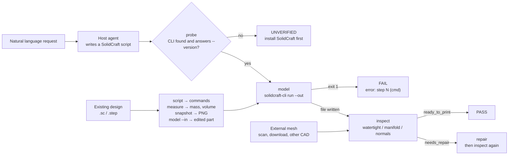

# 3d-fabric

> **Everything this machine needs for 3D, in one plugin — two halves.**
>
> The **CAD half** turns a described part into a SolidCraft script, runs it headlessly, exports STL / STEP / 3MF / OBJ, and immediately inspects the mesh for the defects that stop a slicer — and it reads, edits, measures and previews a design that already exists. The **Blender half** ships thirty skills for the other kind of 3D work: organic and hard-surface modelling, PBR materials, lighting, cameras, rendering, UV texturing, animation, and the quality gate that rejects a bad motion pass.
>
> `scripts/solidcraft.py` is the only file that knows the SolidCraft CLI — it probes the install, verifies it answers `--version`, runs the script, and refuses to report success unless the promised export actually landed on disk. `scripts/engine.py` is the only file that knows geometry, and it delegates every operation to `trimesh` (MIT). `run.py` only orchestrates the seven CAD actions; the Blender skills drive a separate application through its MCP server.

**English** · [简体中文](README_zh.md)

**Version:** 1.1.1 | **CAD actions:** 7 | **Bundled Blender skills:** 30 | **Verified against:** SolidCraft 0.30.1

**Install [SolidCraft](https://solidcraft.io/download) first, then this plugin.** The Blender half also needs a local Blender and a Blender MCP server. Both steps, every platform's command and the self-check are under [Installation](#installation).

---

## Security & Open Source Statement

> **Disclaimer**: This repository is a community plugin written to automate a 3D-modelling workflow. It is not affiliated with, sponsored by, or endorsed by the SolidCraft project. It contains no SolidCraft source code and bundles none of its binaries or assets; SolidCraft must be installed separately by the user. The only SolidCraft material reproduced here is the project's four agent reference documents, copied verbatim under its MIT licence with the copyright notice and NOTICE intact — see [Bundled third-party material](#bundled-third-party-material).
>
> The plugin never sends your model anywhere. It makes no network requests, runs no `eval`, and its only subprocess is the locally installed `solidcraft-cli` that you already have.

---

## Why 3d-fabric?

**If you install one 3D plugin, install this one.** Before it, a machine needed a
modelling skill to produce a part, a separate audit skill to judge it, a viewer
to look at it, and a patching script for the broken STL someone emailed you. Each
one covered a slice and none of them talked to the others. 3d-fabric covers the
whole path — build, edit, measure, preview, verify, repair — in one plugin, one
CLI, one gate format, and one set of exit codes.

What it leaves out is slicing — G-code, supports, overhang and wall analysis —
and, on the artistic side, nothing: 1.1.1 bundles Blender's whole agent skill
family, so organic modelling, materials, lighting, cameras, rendering and
animation are covered here too rather than by a second install.

**When to use which half.** A dimensioned, printable part is CAD: `run.py` and
SolidCraft. Something whose silhouette, surface or motion is the point is
Blender: the bundled skills, which need a local Blender and a Blender MCP
server. The two share one deliverable path — a Blender mesh reaches the printer
through `run.py --action inspect` and `repair` on an exported STL.

An agent can write a parametric CAD script, but it cannot tell whether the result
is printable. And a printable result is not the same thing as a built result:
SolidCraft will happily report `ok` for a cut that missed the part, and a slicer
will happily reject a mesh that closes nowhere.

3d-fabric closes that loop in two halves, and both halves matter:

**The bridge.** The agent speaks natural language; SolidCraft speaks a JSON command list. `scripts/solidcraft.py` finds the CLI wherever it is installed (`--solidcraft`, `SOLIDCRAFT_CLI`, `SOLIDCRAFT_HOME`, `PATH`, or the vendor's default folders), verifies it with `--version` so a stale shim cannot pass, runs the script with `--out`, and checks that every promised file exists and is non-empty. The same bridge answers the questions you have about a design someone else made: `script` turns a `.sc` back into a command list, `model --in` replays a patch against it, `measure` reads its volume, mass and topology out of the B-rep, and `snapshot` renders it to PNG. Exit code, stderr and the per-step results list all land in one report.

**The gate.** `scripts/engine.py` measures what a slicer cares about: watertightness, winding consistency, normal orientation, non-manifold edges, boundary loops and their count, degenerate faces, bounds, signed volume. The verdict is one of `ready_to_print`, `needs_repair` or `blocked`, and every defect carries a code, a severity and a count. A model that fails is never dressed up as a success.

The two halves are deliberately separable: `inspect` and `repair` do **not** require SolidCraft at all. Meshes that came from a scanner, a download or another program stay checkable on a machine that has never installed a CAD application.

---

## Bundled third-party material

`references/solidcraft/` holds the four agent reference documents SolidCraft
publishes for its own MCP server — **modeling**, **editing**, **checking** and
**mechanisms** — together with the small helper scripts and design template that
ship beside `solidcraft-checking`. The plugin's skill reads them for command
shapes, plane axes, ids, reply sizes and the traps that make a build succeed with
the wrong geometry.

What this is, precisely:

- **Verbatim.** Every file is byte-identical to upstream
  `github.com/tangency-labs/solidcraft` at branch `main` (fetched 2026-11-06).
  Nothing was rewritten, trimmed or merged. Per-file SHA-256 values are listed in
  [`references/solidcraft/README.md`](references/solidcraft/README.md).
- **Reference text, not skills.** Their YAML frontmatter is part of the upstream
  file. Nothing in that folder is registered as a Claude Code skill, and
  `run.py` never executes any of it.
- **MIT, with the notice kept.** SolidCraft is dual-licensed MIT OR Apache-2.0;
  this copy is taken under **MIT**. Copyright (c) 2026 SolidCraft contributors.
  [`references/solidcraft/LICENSE-MIT`](references/solidcraft/LICENSE-MIT) carries
  the full MIT text and [`NOTICE`](references/solidcraft/NOTICE) the upstream
  attribution. Those files remain the contributors' copyright and are not covered
  by 3d-fabric's own MIT grant; everything outside `references/solidcraft/` is
  Jiaming Shi's work under MIT.
- **Optional.** Delete the folder and `run.py` still works — you only lose the
  built-in command reference and fall back to `solidcraft-cli commands`.

The upstream text is written against SolidCraft's MCP tool names (`batch`,
`execute`, `measure`). The command names inside `{"commands": [...]}` are the same
ones; the MCP call names are not accepted by `solidcraft-cli run`. Where the two
disagree, `solidcraft-cli commands` wins.

---

## The Blender half

Thirty skills ship in `skills/`, copied verbatim from
[RobLe3/cc-blender-skill](https://github.com/RobLe3/cc-blender-skill) at
commit `a2634b5` (MIT).
Each declares its Blender MCP tools in `allowed-tools`, so they only activate
where a Blender MCP server is connected.

| Skill | Covers |
| --- | --- |
| `text-to-blender` | the router: picks the right sub-skill, the MCP backend guide, assembly order |
| `blender-modeling` | meshes, primitives, modifiers, bmesh, hard-surface work |
| `blender-materials` | Principled BSDF, metallic switch, coat/sheen/SSS/transmission, procedural patterns |
| `blender-lighting` | three-point setups, HDRI, colour temperature, light groups |
| `blender-cameras` | focal length, depth of field, composition, animated cameras |
| `blender-rendering` | Cycles vs EEVEE, samples, denoising, AgX/Filmic, output formats |
| `blender-animation` | keyframes, F-curves, easing, shape keys, drivers, NLA |
| `blender-export` | glTF/GLB, FBX, OBJ, USD, STL, collision hulls, normal baking |
| `blender-uv-texturing` | unwrap, atlas mapping, projection, baking, decals |
| `blender-pro-workflow` | the order to assemble a scene, critique protocol, time budgets |
| `blender-skill-harmonizer` | precedence and handoffs when several of the above apply |
| `orbital-hud-motion` | circular HUD, aura rings, orbit arcs around a subject |
| `animation-quality-gate` | contact sheets, flicker and silhouette checks before accepting a pass |

The other seventeen reconstruct a model **from supplied references** — the family
that makes "match this sheet exactly" possible:

| Skill | Covers |
| --- | --- |
| `reference-to-3d` | rebuild from reference sheets, orthographic views, brand or mascot art |
| `wireframe-to-3d` | orthographic wireframe drawings → model, exported as glTF/GLB |
| `mascot-logo-reconstruction` | fail-gated, source-locked mascot / logo / avatar rebuild |
| `orthographic-registration` | register front/side/back/top views into one coordinate contract |
| `multiview-constraint-solver` | decide whether one rigid model can satisfy every view; emit constraints (no Blender tool needed) |
| `multiview-fit-loop` | compare-adjust-repeat fitting against the templates |
| `fit-repair-optimizer` | turn fit reports into a repair queue |
| `landmark-fit-repair` | repair against named landmarks (tips, corners, eyes, rim thickness) |
| `reference-analysis-validator` | validate the supplied references before calling a rebuild 1:1 |
| `reference-look-calibration` | calibrate materials, light, crop, glow and HUD styling against the original |
| `source-part-segmentation` | plan how a reference splits into parts (no Blender tool needed) |
| `contour-to-mesh` | build surfaces from extracted contours and masks |
| `atlas-uv-fitting` | map each source part to its own atlas rectangle |
| `closed-surface-uv-coverage` | cover caps and sidewalls of closed or extruded assets |
| `texture-driven-mesh-fitting` | reshape geometry to texture or decal contours |
| `texture-state-animation` | texture-state transitions without crossfades or popping |
| `quality-refinement-autoloop` | self-refine when a result misses the bar |

**What this half needs:** Blender installed on the machine, and one Blender MCP
server connected (`mcp__blender__*` from ahujasid/blender-mcp, or
`mcp__blender_official__*`). Without them the CAD half still runs; the Blender
skills say what is missing instead of pretending to render.

**Not edited here.** They are upstream text; routing and local advice live in
`skills/3d-fabric/SKILL.md` and `AGENTS.md`. `skills/vendored.json` records the
upstream commit date and a SHA-256 per file, and `tests/test_bundled_skills.py`
fails if a file and its hash disagree.

---

## How a run flows

`run.py` is a thin CLI over seven actions. `probe` is the gate on the environment; `model`, `script`, `measure` and `snapshot` need it; `inspect` and `repair` do not.



A built model yields three files side by side: the mesh (`bracket.stl`), an editable design (`bracket.sc`) and the exact script that produced it (`bracket.solidcraft.json`). Editing the `.sc` in SolidCraft and re-exporting, or re-running the script, both reproduce the part — and `script` recovers that same command list from a design that arrived without one.

---

## Installation

Install the whole thing as one plugin: `run.py`, `scripts/` and `skills/` share one engine, and a scattered copy fails.

### Prerequisite: install SolidCraft

3d-fabric ships no solid kernel; it drives a SolidCraft installation you already have. SolidCraft is open source and free (MIT / Apache-2.0 dual licence) and has to be installed separately:

| Platform | Download |
| --- | --- |
| Windows | [solidcraft-windows-x64.msi](https://github.com/tangency-labs/solidcraft/releases/latest/download/solidcraft-windows-x64.msi) |
| macOS | [solidcraft-macos-universal.dmg](https://github.com/tangency-labs/solidcraft/releases/latest/download/solidcraft-macos-universal.dmg) (Apple silicon and Intel) |
| Linux | [solidcraft-linux-x86_64.AppImage](https://github.com/tangency-labs/solidcraft/releases/latest/download/solidcraft-linux-x86_64.AppImage), or `sudo snap install solidcraft` |

- Everything else — ARM64 and 32-bit builds, portable zip, `.deb`, `.rpm`, Flatpak — is on the [downloads page](https://solidcraft.io/download).
- The Windows downloads are not code-signed yet, so SmartScreen stops you once: **More info → Run anyway**.
- The browser build at <https://solidcraft.io> needs no install, but it exposes no `solidcraft-cli`, so **this plugin cannot use it**.

`solidcraft-cli --version` printing a version line is enough; if it is not on `PATH`, point at it with `--solidcraft`, `SOLIDCRAFT_CLI` or `SOLIDCRAFT_HOME` — details in [docs/INSTALL_COMMANDS.md](docs/INSTALL_COMMANDS.md).

> **Only four actions need it**: `model`, `script`, `measure`, `snapshot`. `inspect` and `repair` do not — a mesh from a scanner, a download or another CAD package stays checkable and repairable on a machine that has never installed SolidCraft.

### Prerequisite: Blender (only if you want that half)

The thirty Blender skills need two things, both from the Blender ecosystem and neither bundled here:

1. **A local Blender** — <https://www.blender.org/download/> (4.x is fine)
2. **A Blender MCP server**, exposing Blender as the `mcp__blender__*` or `mcp__blender_official__*` tool set

With either missing, the Blender skills say what is missing rather than describing a render they did not make. The CAD half is unaffected — `run.py` never touches Blender.

### Method 1: install from the plugin marketplace by URL

Every host has a plugin marketplace of its own. Register this repository's Git URL and install the plugin it lists (registering twice is harmless — the second call reports it is already known).

```bash
https://github.com/JiamingShi-JsPhys/3d-fabric
```

An unpublished, renamed or moved repository changes nothing: the marketplace manifest uses `source: "./"`, a relative path, so the line above can be replaced with the folder you already have — installing never touches the network.

### Method 2: install with commands

Claude Code, Codex, dsh and CodeBuddy each take one plugin command; Cursor, Windsurf, Cline, Continue, Roo Code, GitHub Copilot and opencode read rule files, and one script writes them all. Every host's full command, every `install.py` flag and the optional capabilities are on this page: **[docs/INSTALL_COMMANDS.md](docs/INSTALL_COMMANDS.md)**.

### Method 3: let your AI install it

```bash
Please visit the GitHub repository `https://github.com/JiamingShi-JsPhys/3d-fabric`, clone it, and run `python install.py --check --deps`. If your host has a plugin system, install the whole set as a single plugin instead; that script covers the hosts that read rule files.
```

> **Warning**: an AI that copies `run.py` without `scripts/` can scatter the files into unrelated directories. Modules import each other, and a loose copy fails outright. If you want the complete plugin, use Method 1.

---

## Quick start

### The seven actions

| Action | Does | Needs SolidCraft |
| --- | --- | --- |
| `probe` | Locate and verify the CLI | — (looks for it) |
| `model` | Run a script, export, auto-inspect; `--in` edits an existing design | **yes** |
| `script` | Turn a `.sc` / `.step` back into a `{"commands": [...]}` script | **yes** |
| `measure` | Volume, mass, area, bounds, face types and parameters from the B-rep | **yes** |
| `snapshot` | Render a PNG preview (views, sections, per-body styling) | **yes** |
| `inspect` | Print-quality report on any mesh | no |
| `repair` | Weld, fill holes, fix normals | no |

```bash
python run.py --action probe
python run.py --action model    --input examples/bracket_request.json --quality fine
python run.py --action script   --input bracket.sc --output build.json
python run.py --action model    --script widen.json --in bracket.sc --output bracket_150.stl
python run.py --action measure  --input bracket.sc
python run.py --action snapshot --input bracket.sc --output bracket.png --view iso
python run.py --action inspect  --input examples/damaged_part.stl
python run.py --action repair   --input examples/damaged_part.stl --center
```

### From the chat box

Once installed as a plugin, the skill is one `/` away and triggers on the
vocabulary of the task — "3D 打印", "参数化建模", "建一个实体模型", "做个外壳/支架",
or a request to check an STL before slicing.

```text
/3d-fabric  一块 120x70x8 的转接板，四角 R8 圆角，中间 40x20 通孔，四角 Ø4.5 孔距边 12mm
```

The agent probes, writes the SolidCraft script, calls `model`, reads the gate, and
reports the size, volume and verdict — or fixes the failing step and re-runs.
When the design already exists, it calls `script` to read it, `measure` for the
mass and volume, `snapshot` for a picture, and `model --in` to apply the change.
The full operating rules, including how to read `error: step N`, are in
[skills/3d-fabric/SKILL.md](skills/3d-fabric/SKILL.md).

### When you need the CLI

Everything is available headlessly for scripts and CI: the action set, the
transform flags, the gate JSON schema and the exit codes are documented below
and in [skills/3d-fabric/SKILL.md](skills/3d-fabric/SKILL.md).

```bash
python run.py --action model --input req.json --root ./ws --json
```

With `--root`, the gate lands at `<root>/process/gates/3d-fabric_<timestamp>.json`
and its contents are byte-identical to the `--json` line on stdout.

---

## Requirements

Python 3.10+ and `trimesh`, `numpy` and `scipy` — all permissively licensed
(MIT / BSD-3-Clause) and installed with `python -m pip install -r requirements.txt`.

**SolidCraft** is required for `model`, `script`, `measure` and `snapshot`. The
plugin does not ship it; [Prerequisite: install SolidCraft](#prerequisite-install-solidcraft) above covers the
downloads (MIT OR Apache-2.0, <https://solidcraft.io/download>). `probe` accepts
the CLI from `--solidcraft`, `SOLIDCRAFT_CLI`, `SOLIDCRAFT_HOME`, `PATH`, or the
usual install folders, and verifies each candidate by running `--version` — a
file that cannot answer is not accepted.

**Blender** and a Blender MCP server are required for the thirty bundled
skills, and neither is shipped here — see [Prerequisite: Blender](#prerequisite-blender-only-if-you-want-that-half)
(Blender from <https://www.blender.org/download/>). The skills activate only
when `mcp__blender__*` or `mcp__blender_official__*` tools are present. Nothing
in `run.py` touches Blender.

Nothing is vendored. `numpy-stl` appears only in the test suite, as an
independent STL reader used to prove exported files are standard STL.

---

## Repository layout

```text
3d-fabric/
├── .claude-plugin/                   # Claude Code plugin manifest + marketplace
├── .clinerules/                      # Cline rule file
├── .codebuddy-plugin/                # CodeBuddy plugin manifest + marketplace
├── .codex-plugin/                    # Codex plugin manifest + marketplace (+ interface)
├── .continue/rules/                  # Continue rule file
├── .cursor/rules/                    # Cursor rule file (.mdc)
├── .dsh-plugin/                      # dsh directory entry (delegates to index.js)
├── .github/                          # GitHub Copilot rule file
├── .gitattributes                    # LF normalisation; binary meshes marked
├── .gitignore
├── .roo/rules/                       # Roo Code rule file
├── .windsurf/rules/                  # Windsurf rule file
├── AGENTS.md                         # agent operating rules — the body of all six rule files
├── CHANGELOG.md                      # release notes
├── LICENSE                           # MIT
├── README.md                         # this file
├── README_zh.md                      # 简体中文
├── THIRD_PARTY_LICENSES.txt          # upstream licences + SolidCraft relationship
├── cordis.patch.yml                  # dsh: inserts the plugin into a profile
├── docs/
│   ├── INSTALL_COMMANDS.md           # every host's install command, every install.py flag
│   ├── INSTALL_COMMANDS_zh.md        # the same, in Chinese
│   └── DEPENDENCIES.md               # capability / dependency / missing-behaviour matrix
├── examples/
│   ├── bracket_request.json          # natural language + 21 SolidCraft commands
│   ├── damaged_part.stl              # holed sphere for inspect / repair demos
│   └── make_demo.py                  # regenerates damaged_part.stl
├── index.js                          # dsh entry: registers every skills/*/SKILL.md
├── install.py                        # --check / --deps / --skill-dir / --project / --global
├── licenses/
│   └── cc-blender-skill-LICENSE.txt  # upstream MIT text for the bundled skills
├── manifest.json                     # skill-pipeline metadata (stage, actions, deps)
├── package.json                      # dsh package manifest (dsh.bundle.patch)
├── pyproject.toml                    # package metadata + pytest/pyright config
├── requirements.txt
├── references/
│   └── solidcraft/                   # SolidCraft's four agent references, verbatim (MIT)
│                                     #   README.md: provenance, hashes, update steps
├── run.py                            # CLI: probe / model / script / measure /
│                                     #      snapshot / inspect / repair
├── scripts/
│   ├── engine.py                     # trimesh geometry: load, transform, analyze, repair, export
│   └── solidcraft.py                 # CLI bridge: probe, run, eval, snapshot, script
├── skills/
│   ├── vendored.json                 # upstream URL, fetch date, SHA-256 per skill file
│   ├── 3d-fabric/                    # this plugin's own skill: CAD half + routing
│   └── <30 Blender skills>/          # verbatim from github.com/RobLe3/cc-blender-skill
│                                     #   (MIT): 11 production + 2 HUD/animation QA
│                                     #   + 17 reference-reconstruction skills
└── tests/
    ├── conftest.py                   # generated fixtures (no binary blobs)
    ├── stub_solidcraft.py            # test double for the CLI
    ├── test_actions.py               # measure / snapshot / script, model --in
    ├── test_bundled_skills.py        # Blender skills present, bound to an MCP, hashes match
    ├── test_cli.py                   # exit codes, gate files, stdout contract
    ├── test_dsh_bundle.py            # dsh.bundle.patch, the CJS entry, version agreement
    ├── test_engine.py                # geometry, defects, repair, export
    ├── test_model.py                 # the full build → inspect chain
    ├── test_plugin_manifests.py      # four plugin manifests + six rule files stay in step
    ├── test_references.py            # SolidCraft references present, hashes match
    └── test_solidcraft.py            # probe, run, failure and silent-success cases
```

---

## Tests

```bash
python -m pytest
```

That is 124 tests. They cover the geometry engine (loading STL with welding,
transforms about a pivot, every defect class, hole filling on quads and on a
32-gon boundary, inverted shells, export round-trips against an independent
STL reader), the CLI contract (exit codes, gate files, human and `--json`
output), the design-reading actions (`measure` totals and open bodies,
`snapshot` PNG output, `script` extraction, `model --in`), the bundled
references (presence, provenance hashes against the README table, the MIT text,
and that `install.py --skill-dir` copies them), the bundled Blender skills
(present, named by their frontmatter, every one bound to a Blender MCP tool set,
cross-skill links resolving, hashes matching `skills/vendored.json`), the dsh
package (the `dsh.bundle.patch` declaration, the CJS entry listing all
thirty-one skills, version agreement with the Claude Code manifests), the
platform half (all four plugin manifests and all six rule files, each rule file
pinned to `AGENTS.md` so one edit cannot leave a host behind), the installer's
own checks, and the SolidCraft bridge through a Python stub CLI — so the suite
passes on a machine with SolidCraft installed or not. When the real CLI is
present, one integration test runs against it and is skipped otherwise.

---

## Known limitations

Honest edge cases — read before relying on any output:

- **The gate checks geometry, not intent.** A watertight model can still be the wrong part. Compare the reported `volume` and `extents` with what you calculated; SolidCraft reports success for a cut that missed entirely.
- **Hole filling is a planar fan.** A loop whose out-of-plane thickness exceeds 5% of its radius is skipped with a note instead of being filled badly, and a curved surface spanning the hole is never recreated.
- **Non-manifold edges are reported, not repaired.** An edge shared by three faces leaves `success: false` and its count in `after.topology`; splitting it needs a CAD tool.
- **Self-intersections are not detected** — `trimesh` has no robust routine for it.
- **STEP is not inspected.** It is a B-rep with no triangles; export STL first.
- **`--quality fine|finest` needs a JSON script.** Tessellation quality is a per-command setting in SolidCraft, so the export is injected into the script; `.sc` designs use the default and say so in `notes`.
- **`script` is a reconstruction, not a source file.** Steps that depend on saved design state (SolidCraft's `timeline.add`) come back with the CLI's own replay note attached to the gate; replay it with `model`, don't assume it rebuilds byte-for-byte.
- **One model at a time.** An assembly is reported through `body_count`, not split or arranged.
- **Units are assumed.** STL carries none; the report says `mm` and marks it as an assumption.

---

## Report issues

**Regular bugs / feature requests**: file them on the repository's [Issues](https://github.com/JiamingShi-JsPhys/3d-fabric/issues) page. Include the gate JSON, the script that reproduced it (or a minimal one), and your SolidCraft version from `python run.py --action probe`.

**Security vulnerabilities (this category only)**: do **not** use the public Issues page. Email `jiamingshi_git@outlook.com` instead.

- **Subject**: must carry the prefix `_report` plus the product name and a short summary.
  - Example: `report_3d-fabric: requirement JSON can write outside the output directory`
- **Body**: must include reproduction steps, the exact command line, and the environment.

---

## Trademarks

"SolidCraft" is the name of the open-source CAD application this plugin drives;
it is used here only to describe compatibility. 3d-fabric is an independent,
third-party plugin and is not affiliated with, endorsed by, or sponsored by the
SolidCraft project or its contributors.

---

## License

MIT. See [LICENSE](LICENSE).

That grant covers this project's own work: `run.py`, `scripts/`, the
`3d-fabric` skill, `install.py`, the docs and the tests. It does **not** cover
the third-party material bundled inside:

- `skills/` — thirty Blender skills, © 2026 RobLe3, MIT
  ([licence](licenses/cc-blender-skill-LICENSE.txt)).
- `references/solidcraft/` — four SolidCraft agent references,
  © 2026 SolidCraft contributors, MIT
  ([licence](references/solidcraft/LICENSE-MIT)).

Both were copied verbatim and their notices travel with them, as MIT requires.
See [THIRD_PARTY_LICENSES.txt](THIRD_PARTY_LICENSES.txt) for the full list.

**Author & Maintainer**: Jiaming Shi
