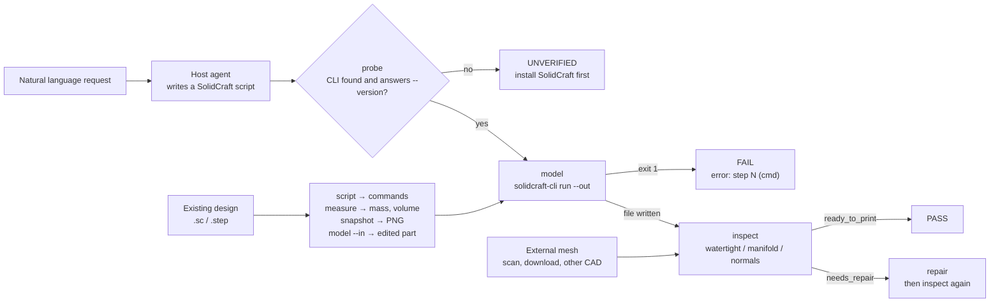

# 3d-fabric

> **Everything this machine needs for 3D modelling and 3D printing, in one plugin.**
>
> Describe the part you want. The host agent turns that description into a SolidCraft script; this plugin runs it headlessly, exports STL / STEP / 3MF / OBJ, and immediately inspects the mesh for the defects that stop a slicer: open surfaces, non-manifold edges, inverted normals, degenerate faces. If you already have a design, the same plugin opens it, edits it, measures it, renders a preview of it, and repairs meshes that came from somewhere else.
>
> `scripts/solidcraft.py` is the only file that knows the SolidCraft CLI — it probes the install, verifies it answers `--version`, runs the script, and refuses to report success unless the promised export actually landed on disk. `scripts/engine.py` is the only file that knows geometry, and it delegates every operation to `trimesh` (MIT). `run.py` only orchestrates the seven actions.

**English** · [简体中文](README_zh.md)

**Version:** 1.0.0 | **Actions:** 7 | **Verified against:** SolidCraft 0.30.1

---

## Security & Open Source Statement

> **Disclaimer**: This repository is a community plugin written to automate a 3D-modelling workflow. It is not affiliated with, sponsored by, or endorsed by the SolidCraft project. It contains no SolidCraft source code and bundles none of its binaries or assets; SolidCraft must be installed separately by the user. The only SolidCraft material reproduced here is the project's four agent reference documents, copied verbatim under its MIT licence with the copyright notice and NOTICE intact — see [Bundled third-party material](#bundled-third-party-material).
>
> The plugin never sends your model anywhere. It makes no network requests, runs no `eval`, and its only subprocess is the locally installed `solidcraft-cli` that you already have.

---

## Why 3d-fabric?

**If you install one 3D plugin, install this one.** Before it, a machine needed a
modelling skill to produce a part, a separate audit skill to judge it, a viewer
to look at it, and a patching script for the broken STL someone emailed you. Each
one covered a slice and none of them talked to the others. 3d-fabric covers the
whole path — build, edit, measure, preview, verify, repair — in one plugin, one
CLI, one gate format, and one set of exit codes.

What it deliberately leaves out is organic modelling, sculpting, materials,
lighting and animation; those belong to Blender-class tools, not a parametric CAD
front end.

An agent can write a parametric CAD script, but it cannot tell whether the result
is printable. And a printable result is not the same thing as a built result:
SolidCraft will happily report `ok` for a cut that missed the part, and a slicer
will happily reject a mesh that closes nowhere.

3d-fabric closes that loop in two halves, and both halves matter:

**The bridge.** The agent speaks natural language; SolidCraft speaks a JSON command list. `scripts/solidcraft.py` finds the CLI wherever it is installed (`--solidcraft`, `SOLIDCRAFT_CLI`, `SOLIDCRAFT_HOME`, `PATH`, or the vendor's default folders), verifies it with `--version` so a stale shim cannot pass, runs the script with `--out`, and checks that every promised file exists and is non-empty. The same bridge answers the questions you have about a design someone else made: `script` turns a `.sc` back into a command list, `model --in` replays a patch against it, `measure` reads its volume, mass and topology out of the B-rep, and `snapshot` renders it to PNG. Exit code, stderr and the per-step results list all land in one report.

**The gate.** `scripts/engine.py` measures what a slicer cares about: watertightness, winding consistency, normal orientation, non-manifold edges, boundary loops and their count, degenerate faces, bounds, signed volume. The verdict is one of `ready_to_print`, `needs_repair` or `blocked`, and every defect carries a code, a severity and a count. A model that fails is never dressed up as a success.

The two halves are deliberately separable: `inspect` and `repair` do **not** require SolidCraft at all. Meshes that came from a scanner, a download or another program stay checkable on a machine that has never installed a CAD application.

---

## Bundled third-party material

`references/solidcraft/` holds the four agent reference documents SolidCraft
publishes for its own MCP server — **modeling**, **editing**, **checking** and
**mechanisms** — together with the small helper scripts and design template that
ship beside `solidcraft-checking`. The plugin's skill reads them for command
shapes, plane axes, ids, reply sizes and the traps that make a build succeed with
the wrong geometry.

What this is, precisely:

- **Verbatim.** Every file is byte-identical to upstream
  `github.com/tangency-labs/solidcraft` at branch `main` (fetched 2026-11-06).
  Nothing was rewritten, trimmed or merged. Per-file SHA-256 values are listed in
  [`references/solidcraft/README.md`](references/solidcraft/README.md).
- **Reference text, not skills.** Their YAML frontmatter is part of the upstream
  file. Nothing in that folder is registered as a Claude Code skill, and
  `run.py` never executes any of it.
- **MIT, with the notice kept.** SolidCraft is dual-licensed MIT OR Apache-2.0;
  this copy is taken under **MIT**. Copyright (c) 2026 SolidCraft contributors.
  [`references/solidcraft/LICENSE-MIT`](references/solidcraft/LICENSE-MIT) carries
  the full MIT text and [`NOTICE`](references/solidcraft/NOTICE) the upstream
  attribution. Those files remain the contributors' copyright and are not covered
  by 3d-fabric's own MIT grant; everything outside `references/solidcraft/` is
  Jiaming Shi's work under MIT.
- **Optional.** Delete the folder and `run.py` still works — you only lose the
  built-in command reference and fall back to `solidcraft-cli commands`.

The upstream text is written against SolidCraft's MCP tool names (`batch`,
`execute`, `measure`). The command names inside `{"commands": [...]}` are the same
ones; the MCP call names are not accepted by `solidcraft-cli run`. Where the two
disagree, `solidcraft-cli commands` wins.

---

## How a run flows

`run.py` is a thin CLI over seven actions. `probe` is the gate on the environment; `model`, `script`, `measure` and `snapshot` need it; `inspect` and `repair` do not.



A built model yields three files side by side: the mesh (`bracket.stl`), an editable design (`bracket.sc`) and the exact script that produced it (`bracket.solidcraft.json`). Editing the `.sc` in SolidCraft and re-exporting, or re-running the script, both reproduce the part — and `script` recovers that same command list from a design that arrived without one.

---

## Installation

Three ways in. The plugin channel is the one that gets you the skill wired into the agent; the install script covers the environment checks a plugin channel cannot do.

### Method 1: install from the plugin marketplace by URL

Register this repository's Git URL, then install the plugin it lists (registering twice is harmless — the second call reports it is already known).

```bash
https://github.com/JiamingShi-JsPhys/3d-fabric
```

### Method 2: install with commands

**Claude Code** — from your shell:

```bash
claude plugin install 3d-fabric --marketplace https://github.com/JiamingShi-JsPhys/3d-fabric.git
```

**Claude Code** — from inside a session, add the marketplace pinned to the release tag:

```text
/plugin marketplace add https://github.com/JiamingShi-JsPhys/3d-fabric.git#v1.0.0
```

Then install the entry it lists:

```text
/plugin install 3d-fabric@3d-fabric-marketplace
```

**Manual** — if you would rather not use a marketplace, clone the repository and run it in place:

```bash
python -m pip install -r requirements.txt
python run.py --action probe
```

**dsh** — DeepSeek Harness installs plugins as npm packages. The repository therefore carries a `package.json` and a `cordis.patch.yml` beside the Claude Code manifests, and `index.js` registers the skill with dsh's skill registry:

```bash
dsh plugin --profile desktop add github:JiamingShi-JsPhys/3d-fabric
```

dsh refuses any package whose `package.json` lacks `dsh.bundle.patch` — that is the *"这个包没有声明组合包"* refusal (`reasonNotBundle`), and it is why 1.0.0 would not install there. Upgrading means uninstalling first; dsh does not replace an installed version in place.

**Codex** — register the URL as a Git marketplace, then install from it (`--ref` pins the release tag; an SSH URL or a local path works in place of the HTTPS one):

```bash
codex plugin marketplace add https://github.com/JiamingShi-JsPhys/3d-fabric.git --ref v1.0.0
codex plugin add 3d-fabric@3d-fabric-marketplace
```

**CodeBuddy** — the same shape as Claude Code:

```text
/plugin marketplace add https://github.com/JiamingShi-JsPhys/3d-fabric.git#v1.0.0
```

```text
/plugin install 3d-fabric@3d-fabric-marketplace
```

**Cursor, Windsurf, Cline, Continue, Roo Code, GitHub Copilot** — these read a rule file from their own location, and none of them accepts this repository as a plugin. **No vendor ships an installer that understands another vendor's rule file**, so this repository ships one:

```bash
git clone https://github.com/JiamingShi-JsPhys/3d-fabric.git
python 3d-fabric/install.py --project <your-project>
```

That one command writes every project-scoped rule file at once — `.cursor/rules/3d-fabric.mdc`, `.windsurf/rules/3d-fabric.md`, `.clinerules/3d-fabric.md`, `.continue/rules/3d-fabric.md`, `.roo/rules/3d-fabric.md`, `.github/copilot-instructions.md`, and the generic `AGENTS.md` that Codex, opencode and Copilot agents also read. `--global` adds the user-scoped `AGENTS.md` for opencode (`~/.config/opencode/`) and Codex (`$CODEX_HOME` or `~/.codex/`), skipping any host this machine does not have. `--list` prints every destination without writing, `--dry-run` previews the run, `--only cursor,codex` narrows it.

Re-running is safe: an identical file reports `unchanged`, and a rule file that has drifted is left alone unless you pass `--force`. Every rule file is `AGENTS.md` verbatim behind that host's header, so one edit to the contract reaches all six — and `tests/test_plugin_manifests.py` fails if they drift apart.

None of these hosts carries the Python prerequisites for you: the seven actions still need `pip install -r requirements.txt` and a local SolidCraft.

### Method 3: let your AI install it

```bash
Please visit the GitHub repository `https://github.com/JiamingShi-JsPhys/3d-fabric`, clone it, and run `python install.py --check --deps`. If your host has a plugin system, install it as a plugin instead so the skill keeps its trigger conditions.
```

> **Warning**: an AI that copies `run.py` on its own without `scripts/` will get a plugin that cannot import anything. Install through the marketplace or let `install.py` do the copy — it keeps `run.py`, `scripts/` and `skills/` together.

---

## Quick start

### The seven actions

| Action | Does | Needs SolidCraft |
| --- | --- | --- |
| `probe` | Locate and verify the CLI | — (looks for it) |
| `model` | Run a script, export, auto-inspect; `--in` edits an existing design | **yes** |
| `script` | Turn a `.sc` / `.step` back into a `{"commands": [...]}` script | **yes** |
| `measure` | Volume, mass, area, bounds, face types and parameters from the B-rep | **yes** |
| `snapshot` | Render a PNG preview (views, sections, per-body styling) | **yes** |
| `inspect` | Print-quality report on any mesh | no |
| `repair` | Weld, fill holes, fix normals | no |

```bash
python run.py --action probe
python run.py --action model    --input examples/bracket_request.json --quality fine
python run.py --action script   --input bracket.sc --output build.json
python run.py --action model    --script widen.json --in bracket.sc --output bracket_150.stl
python run.py --action measure  --input bracket.sc
python run.py --action snapshot --input bracket.sc --output bracket.png --view iso
python run.py --action inspect  --input examples/damaged_part.stl
python run.py --action repair   --input examples/damaged_part.stl --center
```

### From the chat box

Once installed as a plugin, the skill is one `/` away and triggers on the
vocabulary of the task — "3D 打印", "参数化建模", "建一个实体模型", "做个外壳/支架",
or a request to check an STL before slicing.

```text
/3d-fabric  一块 120x70x8 的转接板，四角 R8 圆角，中间 40x20 通孔，四角 Ø4.5 孔距边 12mm
```

The agent probes, writes the SolidCraft script, calls `model`, reads the gate, and
reports the size, volume and verdict — or fixes the failing step and re-runs.
When the design already exists, it calls `script` to read it, `measure` for the
mass and volume, `snapshot` for a picture, and `model --in` to apply the change.
The full operating rules, including how to read `error: step N`, are in
[skills/3d-fabric/SKILL.md](skills/3d-fabric/SKILL.md).

### When you need the CLI

Everything is available headlessly for scripts and CI: the action set, the
transform flags, the gate JSON schema and the exit codes are documented below
and in [skills/3d-fabric/SKILL.md](skills/3d-fabric/SKILL.md).

```bash
python run.py --action model --input req.json --root ./ws --json
```

With `--root`, the gate lands at `<root>/process/gates/3d-fabric_<timestamp>.json`
and its contents are byte-identical to the `--json` line on stdout.

---

## Requirements

Python 3.10+ and `trimesh`, `numpy` and `scipy` — all permissively licensed
(MIT / BSD-3-Clause) and installed with `python -m pip install -r requirements.txt`.

**SolidCraft** is required for `model`, `script`, `measure` and `snapshot`. The
plugin does not ship it; install it from
<https://github.com/tangency-labs/solidcraft> (MIT OR Apache-2.0). `probe`
accepts the CLI from `--solidcraft`, `SOLIDCRAFT_CLI`, `SOLIDCRAFT_HOME`, `PATH`,
or the usual install folders, and verifies each candidate by running
`--version` — a file that cannot answer is not accepted.

Nothing is vendored. `numpy-stl` appears only in the test suite, as an
independent STL reader used to prove exported files are standard STL.

---

## Repository layout

```text
3d-fabric/
├── .claude-plugin/                   # Claude Code plugin manifest + marketplace
├── .clinerules/                      # Cline rule file
├── .codebuddy-plugin/                # CodeBuddy plugin manifest + marketplace
├── .codex-plugin/                    # Codex plugin manifest + marketplace (+ interface)
├── .continue/rules/                  # Continue rule file
├── .cursor/rules/                    # Cursor rule file (.mdc)
├── .dsh-plugin/                      # dsh directory entry (delegates to index.js)
├── .github/                          # GitHub Copilot rule file
├── .gitattributes                    # LF normalisation; binary meshes marked
├── .gitignore
├── .roo/rules/                       # Roo Code rule file
├── .windsurf/rules/                  # Windsurf rule file
├── AGENTS.md                         # agent operating rules — the body of all six rule files
├── CHANGELOG.md                      # release notes
├── LICENSE                           # MIT
├── README.md                         # this file
├── README_zh.md                      # 简体中文
├── THIRD_PARTY_LICENSES.txt          # upstream licences + SolidCraft relationship
├── cordis.patch.yml                  # dsh: inserts the plugin into a profile
├── examples/
│   ├── bracket_request.json          # natural language + 21 SolidCraft commands
│   ├── damaged_part.stl              # holed sphere for inspect / repair demos
│   └── make_demo.py                  # regenerates damaged_part.stl
├── index.js                          # dsh entry: registers skills/ with the skill registry
├── install.py                        # --check / --deps / --skill-dir / --project / --global
├── manifest.json                     # skill-pipeline metadata (stage, actions, deps)
├── package.json                      # dsh package manifest (dsh.bundle.patch)
├── pyproject.toml                    # package metadata + pytest/pyright config
├── requirements.txt
├── references/
│   └── solidcraft/                   # SolidCraft's four agent references, verbatim (MIT)
│                                     #   README.md: provenance, hashes, update steps
├── run.py                            # CLI: probe / model / script / measure /
│                                     #      snapshot / inspect / repair
├── scripts/
│   ├── engine.py                     # trimesh geometry: load, transform, analyze, repair, export
│   └── solidcraft.py                 # CLI bridge: probe, run, eval, snapshot, script
├── skills/
│   └── 3d-fabric/
│       └── SKILL.md                  # host-agent operating rules
└── tests/
    ├── conftest.py                   # generated fixtures (no binary blobs)
    ├── stub_solidcraft.py            # test double for the CLI
    ├── test_actions.py               # measure / snapshot / script, model --in
    ├── test_cli.py                   # exit codes, gate files, stdout contract
    ├── test_dsh_bundle.py            # dsh.bundle.patch, the CJS entry, version agreement
    ├── test_engine.py                # geometry, defects, repair, export
    ├── test_model.py                 # the full build → inspect chain
    ├── test_plugin_manifests.py      # four plugin manifests + six rule files stay in step
    └── test_solidcraft.py            # probe, run, failure and silent-success cases
```

---

## Tests

```bash
python -m pytest
```

That is 116 tests. They cover the geometry engine (loading STL with welding,
transforms about a pivot, every defect class, hole filling on quads and on a
32-gon boundary, inverted shells, export round-trips against an independent
STL reader), the CLI contract (exit codes, gate files, human and `--json`
output), the design-reading actions (`measure` totals and open bodies,
`snapshot` PNG output, `script` extraction, `model --in`), the bundled
references (presence, provenance hashes against the README table, the MIT text,
and that `install.py --skill-dir` copies them), the installer's own checks,
the dsh package (the `dsh.bundle.patch` declaration, the CJS entry listing the
bundled skills, version agreement with the Claude Code manifests), the platform
half (all four plugin manifests and all six rule files, each rule file pinned
to `AGENTS.md` so one edit cannot leave a host behind), and the SolidCraft
bridge through a Python stub CLI — so the suite passes on a machine with
SolidCraft installed or not. When the real CLI is present, one integration test
runs against it and is skipped otherwise.

---

## Known limitations

Honest edge cases — read before relying on any output:

- **The gate checks geometry, not intent.** A watertight model can still be the wrong part. Compare the reported `volume` and `extents` with what you calculated; SolidCraft reports success for a cut that missed entirely.
- **Hole filling is a planar fan.** A loop whose out-of-plane thickness exceeds 5% of its radius is skipped with a note instead of being filled badly, and a curved surface spanning the hole is never recreated.
- **Non-manifold edges are reported, not repaired.** An edge shared by three faces leaves `success: false` and its count in `after.topology`; splitting it needs a CAD tool.
- **Self-intersections are not detected** — `trimesh` has no robust routine for it.
- **STEP is not inspected.** It is a B-rep with no triangles; export STL first.
- **`--quality fine|finest` needs a JSON script.** Tessellation quality is a per-command setting in SolidCraft, so the export is injected into the script; `.sc` designs use the default and say so in `notes`.
- **`script` is a reconstruction, not a source file.** Steps that depend on saved design state (SolidCraft's `timeline.add`) come back with the CLI's own replay note attached to the gate; replay it with `model`, don't assume it rebuilds byte-for-byte.
- **One model at a time.** An assembly is reported through `body_count`, not split or arranged.
- **Units are assumed.** STL carries none; the report says `mm` and marks it as an assumption.

---

## Report issues

**Regular bugs / feature requests**: file them on the repository's [Issues](https://github.com/JiamingShi-JsPhys/3d-fabric/issues) page. Include the gate JSON, the script that reproduced it (or a minimal one), and your SolidCraft version from `python run.py --action probe`.

**Security vulnerabilities (this category only)**: do **not** use the public Issues page. Email `jiamingshi_git@outlook.com` instead.

- **Subject**: must carry the prefix `_report` plus the product name and a short summary.
  - Example: `report_3d-fabric: requirement JSON can write outside the output directory`
- **Body**: must include reproduction steps, the exact command line, and the environment.

---

## Trademarks

"SolidCraft" is the name of the open-source CAD application this plugin drives;
it is used here only to describe compatibility. 3d-fabric is an independent,
third-party plugin and is not affiliated with, endorsed by, or sponsored by the
SolidCraft project or its contributors.

---

## License

MIT. See [LICENSE](LICENSE).

**Author & Maintainer**: Jiaming Shi
