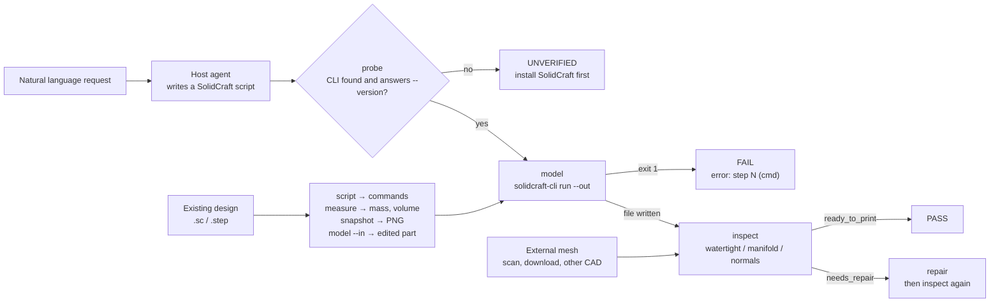

# 3d-fabric

**A print quality gate for 3D modeling and manufacturing workflows, with 30 Blender skills included.**

You do not need to prepare a validation environment yourself. One gate sits behind every path a mesh takes: a natural-language request through the local SolidCraft CLI, a design someone else sent you, an STL off a scanner, or a Blender export. Seven CAD actions share one record format and one set of exit codes, and thirty Blender skills cover the kind of 3D work that is not a dimensioned part.

- **For agents:** a typed gate for every action, `--json` byte-identical to the file on disk, and an explicit `UNVERIFIED` when SolidCraft is missing instead of a silent pass.
- **For people:** one command per task, a verdict in three words, and a `repair` that reports what it changed.
- **For a printer:** watertightness, winding, non-manifold edges and every closed shell checked on its own, so an inside-out part cannot hide behind a correct one.

**English** · [简体中文](README_zh.md)

**Version:** 1.1.1 | **License:** MIT | **Python:** 3.10+ | **SolidCraft:** verified against 0.30.1

> A community plugin, not affiliated with the SolidCraft project. Read the [security statement](#security--open-source-statement) before use.

---

## Contents

**Getting started**

- [Why 3d-fabric](#why-3d-fabric)
- [Installation](#installation)
- [Quick start](#quick-start)

**How it works**

- [The Blender half](#the-blender-half)
- [How a run flows](#how-a-run-flows)
- [Full reference](#full-reference)
- [Security & Open Source Statement](#security--open-source-statement)
- [Bundled third-party material](#bundled-third-party-material)

**The rest**

- [Known limitations](#known-limitations)
- [Report issues](#report-issues)
- [Acknowledgements](#acknowledgements)
- [Trademarks](#trademarks)
- [License](#license)

---

## Why 3d-fabric

An agent can write a parametric CAD script. It cannot tell whether the result is printable — and a printable result is not the same thing as a built one. SolidCraft reports `ok` for a cut that missed the part, exit code 0 does not imply a file was written, and a slicer rejects a mesh that closes nowhere. The tools that answer those questions are usually separate: a modelling skill, an audit skill, a viewer, and a patching script for the broken STL someone emailed you.

3d-fabric addresses this in two parts, and both are part of the same repository.

- **The bridge converts between the two languages.** `scripts/solidcraft.py` finds the CLI wherever it is installed (`--solidcraft`, `SOLIDCRAFT_CLI`, `SOLIDCRAFT_HOME`, `PATH`, or the vendor's default folders), verifies it with `--version` so a stale shim cannot pass, runs the script with `--out`, and checks that every promised file exists and is non-empty. The same bridge answers questions about a design someone else made: `script` turns a `.sc` back into a command list, `model --in` replays a patch against it, `measure` reads its volume, mass and topology out of the B-rep, and `snapshot` renders it to PNG.
- **The gate supplies the verdict the bridge cannot give itself.** `scripts/engine.py` measures what a slicer cares about — watertightness, winding consistency, normal orientation, non-manifold edges, boundary loops, degenerate faces, bounds and signed volume — and reduces them to `ready_to_print`, `needs_repair` or `blocked`. Every defect carries a code, a severity and a count. A model that fails is never reported as a success.
- **The halves are separable on purpose.** `inspect` and `repair` do not require SolidCraft at all, so a mesh from a scanner, a download or another program stays checkable on a machine that has never installed a CAD application.

**Which half to use.** A dimensioned, printable part is CAD: `run.py` and SolidCraft. Something whose silhouette, surface or motion is the point is Blender: the bundled skills, which need a local Blender and a Blender MCP server. They share one deliverable path — a Blender mesh reaches the printer through `run.py --action inspect` and `repair` on an exported STL.

---

## Installation

Install it as one plugin: `run.py`, `scripts/` and `skills/` share one engine, and a scattered copy fails.

**Most people should use Method 1: let your AI install it.** Use Method 2 if your host has a plugin marketplace and you prefer to register the URL yourself; use Method 3 if you install onto several hosts at once.

### Before either: install SolidCraft

3d-fabric ships no solid kernel; it drives the SolidCraft installation you already have. It is open source and free (MIT OR Apache-2.0) and has to be installed separately:

| Platform | Download |
| --- | --- |
| Windows | [solidcraft-windows-x64.msi](https://github.com/tangency-labs/solidcraft/releases/latest/download/solidcraft-windows-x64.msi) |
| macOS | [solidcraft-macos-universal.dmg](https://github.com/tangency-labs/solidcraft/releases/latest/download/solidcraft-macos-universal.dmg) (Apple silicon and Intel) |
| Linux | [solidcraft-linux-x86_64.AppImage](https://github.com/tangency-labs/solidcraft/releases/latest/download/solidcraft-linux-x86_64.AppImage), or `sudo snap install solidcraft` |

- Everything else — ARM64 and 32-bit builds, portable zip, `.deb`, `.rpm`, Flatpak — is on the [downloads page](https://solidcraft.io/download).
- The Windows downloads are not code-signed yet, so SmartScreen stops you once: **More info → Run anyway**.
- The browser build at <https://solidcraft.io> needs no install, but it exposes no `solidcraft-cli`, so **this plugin cannot use it**.
- `solidcraft-cli --version` printing a version line is enough; if it is not on `PATH`, point at it with `--solidcraft`, `SOLIDCRAFT_CLI` or `SOLIDCRAFT_HOME` — details in [docs/INSTALL_COMMANDS.md](docs/INSTALL_COMMANDS.md).

> **Only four actions need it**: `model`, `script`, `measure` and `snapshot`. `inspect` and `repair` do not — a mesh from a scanner, a download or another CAD package stays checkable and repairable on a machine that has never installed SolidCraft.

The thirty Blender skills need two more things, both from the Blender ecosystem and neither bundled here: a local [Blender](https://www.blender.org/download/) (4.x is fine) and a Blender MCP server exposing `mcp__blender__*` or `mcp__blender_official__*`. With either missing, those skills say what is missing rather than describing a render they did not make; `run.py` never touches Blender.

### Method 1: let your AI install it

```bash
Please visit the GitHub repository `https://github.com/JiamingShi-JsPhys/3d-fabric`, clone it, and run `python install.py --check --deps`. If your host has a plugin system, install the whole set as a single plugin instead; that script covers the hosts that read rule files.
```

### Method 2: install from the plugin marketplace by URL

Every host has a plugin marketplace of its own. Register this repository's Git URL and install the plugin it lists (registering twice is harmless — the second call reports it is already known).

```bash
https://github.com/JiamingShi-JsPhys/3d-fabric
```

An unpublished, renamed or moved repository changes nothing: the marketplace manifest uses `source: "./"`, a relative path, so the line above can be replaced with the folder you already have — installing never touches the network.

### Method 3: install with commands

Claude Code, Codex, dsh and CodeBuddy each take one plugin command; Cursor, Windsurf, Cline, Continue, Roo Code, GitHub Copilot and opencode read rule files, and one script writes them all. Every host's full command, every `install.py` flag and the optional capabilities are on one page: **[docs/INSTALL_COMMANDS.md](docs/INSTALL_COMMANDS.md)**.

---

## Quick start

Two ways in. The first needs the plugin installed; the second needs nothing but this repository and a mesh.

### From the chat (no shell, no path)

Once installed as a plugin, the skill is one `/` away and triggers on the vocabulary of the task — "3D 打印", "参数化建模", "建一个实体模型", "做个外壳/支架" — so the first message can be the request itself:

```text
/3d-fabric  一块 120x70x8 的转接板，四角 R8 圆角，中间 40x20 通孔，四角 Ø4.5 孔距边 12mm
```

The agent probes, writes the SolidCraft script, calls `model`, reads the gate and reports the size, volume and verdict — or fixes the failing step and re-runs. When the design already exists, it calls `script` to read it, `measure` for the mass and volume, `snapshot` for a picture, and `model --in` to apply the change. The operating rules, including how to read `error: step N`, are in [skills/3d-fabric/SKILL.md](skills/3d-fabric/SKILL.md).

### From a terminal (no SolidCraft needed for this part)

```bash
python -m pip install -r requirements.txt
python run.py --action inspect --input examples/damaged_part.stl
```

```text
3d-fabric · inspect
  file          examples/damaged_part.stl  (stl)
  size          20.000, 20.000, 16.474  mm (assumed)
  vertices      533   faces 1028   bodies 1
  volume        n/a (open) mm^3
  surface area  1005.864528 mm^2
  topology      watertight[!!] winding[OK] outward[n/a] manifold[OK]
  defects       holes 1   boundary edges 36   non-manifold edges 0   degenerate faces 0
  verdict       needs_repair
    - [error] not_watertight x36: surface is open; a slicer cannot tell inside from outside
    - [error] holes x1: boundary loops that need filling
```

And the repair that makes it printable:

```bash
python run.py --action repair --input examples/damaged_part.stl --output repaired.stl
```

```text
  before        watertight=False holes=1 non-manifold=0 verdict=needs_repair
  after         watertight=True holes=0 non-manifold=0 verdict=ready_to_print
  volume        3725.755796 mm^3
  written       <cwd>/repaired.stl
```

Both transcripts are real output from this repository, on `examples/damaged_part.stl`.

### The seven actions

| Action | Does | Needs SolidCraft |
| --- | --- | --- |
| `probe` | Locate and verify the CLI | — (looks for it) |
| `model` | Run a script, export, auto-inspect; `--in` edits an existing design | **yes** |
| `script` | Turn a `.sc` / `.step` back into a `{"commands": [...]}` script | **yes** |
| `measure` | Volume, mass, area, bounds, face types and parameters from the B-rep | **yes** |
| `snapshot` | Render a PNG preview (views, sections, per-body styling) | **yes** |
| `inspect` | Print-quality report on any mesh | no |
| `repair` | Weld, fill holes, fix normals | no |

```bash
python run.py --action probe
python run.py --action model    --input examples/bracket_request.json --quality fine
python run.py --action script   --input bracket.sc --output build.json
python run.py --action model    --script widen.json --in bracket.sc --output bracket_150.stl
python run.py --action measure  --input bracket.sc
python run.py --action snapshot --input bracket.sc --output bracket.png --view iso
python run.py --action inspect  --input examples/damaged_part.stl
python run.py --action repair   --input examples/damaged_part.stl --center
```

Everything runs headlessly for scripts and CI: with `--root`, the gate lands at `<root>/process/gates/3d-fabric_<timestamp>.json` and its contents are byte-identical to the `--json` line on stdout.

---

## The Blender half

Thirty skills ship in `skills/`, copied verbatim from [RobLe3/cc-blender-skill](https://github.com/RobLe3/cc-blender-skill) at commit `a2634b5` (MIT). They come in three families:

| Family | Skills | For |
| --- | --- | --- |
| Production | 11 | modelling, materials, lighting, cameras, rendering, animation, export, UV texturing, workflow |
| HUD and animation QA | 2 | orbiting HUD motion, and a gate that rejects a bad motion pass |
| Reference reconstruction | 17 | rebuild a model from supplied sheets, wireframes, brand or mascot art |

They need a local Blender and a Blender MCP server (`mcp__blender__*` or `mcp__blender_official__*`); without them the CAD half still runs. Every skill, with what it covers, is in **[docs/BLENDER_SKILLS.md](docs/BLENDER_SKILLS.md)**.

---

## How a run flows

`run.py` is a thin CLI over seven actions. `probe` is the gate on the environment; `model`, `script`, `measure` and `snapshot` need it, and `inspect` and `repair` do not.



Three things the diagram makes explicit:

- **`probe` is the only gate on the environment.** It accepts a CLI only after `--version` exits 0, so a stale shim on `PATH` is rejected rather than used. Four actions need it; `inspect` and `repair` do not.
- **A written file is checked, not assumed.** SolidCraft exits 0 without exporting when the command list did not include the export, so `model` verifies that every promised file exists and is non-empty and turns a silent run into `FAIL`.
- **The CAD path and the external-mesh path end at the same gate.** A part this plugin built and an STL from a scanner are judged by the same `inspect`, the same defect codes and the same three verdicts.

A built model yields three files side by side: the mesh (`bracket.stl`), an editable design (`bracket.sc`) and the exact script that produced it (`bracket.solidcraft.json`). Editing the `.sc` in SolidCraft and re-exporting, or re-running the script, both reproduce the part — and `script` recovers that same command list from a design that arrived without one.

---

## Full reference

The action flags, the gate record, exit codes, the dependency map, the repository layout and the test suite live in **[docs/REFERENCE.md](docs/REFERENCE.md)**, so this page can stay a quick start.

The three words you will meet first: `ready_to_print` is a pass, `needs_repair` means a defect this plugin can fix, and `blocked` means it cannot — a non-manifold edge, an empty file, a zero-thickness part.

---

## Security & Open Source Statement

> **Disclaimer**: This repository is a community plugin written to automate a 3D-modelling workflow. It is not affiliated with, sponsored by, or endorsed by the SolidCraft project. It contains no SolidCraft source code and bundles none of its binaries or assets; SolidCraft must be installed separately by the user. The only SolidCraft material reproduced here is the project's four agent reference documents, copied verbatim under its MIT licence with the copyright notice and NOTICE intact — see [Bundled third-party material](#bundled-third-party-material).
>
> The plugin never sends your model anywhere. It makes no network requests, runs no `eval`, and its only subprocess is the locally installed `solidcraft-cli` that you already have.

---

## Bundled third-party material

`references/solidcraft/` carries SolidCraft's four agent reference documents, copied verbatim under its MIT licence with the copyright notice and NOTICE intact. Nothing there is registered as a skill and `run.py` never executes it; delete the folder and `run.py` still works.

What was copied and why, the one omission, and where the MIT boundary falls are in **[docs/THIRD_PARTY.md](docs/THIRD_PARTY.md)**.

---

## Known limitations

### Read before use

- **The gate checks geometry, not intent.** A watertight model can still be the wrong part. Compare the reported `volume` and `extents` with what you calculated; SolidCraft reports success for a cut that missed entirely.
- **Slicing is out of scope.** G-code, supports, overhang and wall analysis belong to the slicer; 3d-fabric stops at a printability verdict.
- **Non-manifold edges are reported, not repaired.** An edge shared by three faces leaves `success: false` and its count in `after.topology`; splitting it needs a CAD tool.
- **STEP is not inspected.** It is a B-rep with no triangles; export STL first.
- **Units are assumed.** STL carries none; the report says `mm` and marks it as an assumption.

### Edge cases

- **Hole filling is a planar fan.** A loop whose out-of-plane thickness exceeds 5% of its radius is skipped with a note instead of being filled badly, and a curved surface spanning the hole is never recreated.
- **Self-intersections are not detected** — `trimesh` has no robust routine for it, so a mesh that intersects itself can still pass.
- **`--quality fine|finest` needs a JSON script.** Tessellation quality is a per-command setting in SolidCraft, so the export is injected into the script; `.sc` designs use the default and say so in `notes`.
- **`script` is a reconstruction, not a source file.** Steps that depend on saved design state (SolidCraft's `timeline.add`) come back with the CLI's own replay note attached to the gate; replay it with `model`, don't assume it rebuilds byte-for-byte.
- **One model at a time.** An assembly is reported through `body_count`, not split or arranged.
- **The Blender skills are upstream text.** Their behaviour depends on the Blender MCP server you connect and the Blender version you run; the hash tests catch drift in the files, not in Blender.

---

## Report issues

**Regular bugs / feature requests**: file them on the repository's [Issues](https://github.com/JiamingShi-JsPhys/3d-fabric/issues) page. Include the gate JSON, the script that reproduced it (or a minimal one), and your SolidCraft version from `python run.py --action probe`.

**Security vulnerabilities (this category only)**: do **not** use the public Issues page. Email `jiamingshi_git@outlook.com` instead.

- **Subject**: must carry the prefix `report_3d-fabric:` plus a short summary.
  - Example: `report_3d-fabric: requirement JSON can write outside the output directory`
- **Body**: must include reproduction steps, the exact command line, and the environment.

*Contributors who file clear, reproducible issues or pull requests are credited in the next release's notes and in [Acknowledgements](#acknowledgements).*

---

## Acknowledgements

wlheyuyang

[Full acknowledgements](docs/ACKNOWLEDGEMENTS.md)

---

## Trademarks

"SolidCraft" is the name of the open-source CAD application this plugin drives; it is used here only to describe compatibility. 3d-fabric is an independent, third-party plugin and is not affiliated with, endorsed by, or sponsored by the SolidCraft project or its contributors.

---

## License

MIT. See [LICENSE](LICENSE) and [THIRD_PARTY_LICENSES.txt](THIRD_PARTY_LICENSES.txt).

**Author & Maintainer**: Jiaming Shi
