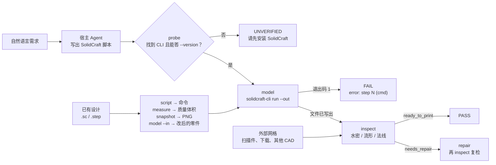

# 3d-fabric

> **这台机器上 3D 建模与 3D 打印需要的一切，一个插件。**
>
> 你说想要什么零件，宿主 Agent 把它翻译成 SolidCraft 脚本；本插件静默执行脚本，导出 STL / STEP / 3MF / OBJ，并立刻检查那些会让切片软件拒收的缺陷：未闭合表面、非流形边、法线反向、退化面。如果零件已经存在，还是这个插件：打开它、改它、量它、给它出图，以及修好别人递来的破网格。
>
> `scripts/solidcraft.py` 是唯一认识 SolidCraft CLI 的文件——它探测安装位置、用 `--version` 验活、执行脚本，并且在承诺的导出文件没有真正落盘时拒绝报告成功。`scripts/engine.py` 是唯一认识几何的文件，所有运算都委托给 `trimesh`（MIT）。`run.py` 只负责编排这七个动作。

[English](README.md) · **简体中文**

**版本：** 1.0.0 | **动作数：** 7 | **已验证于：** SolidCraft 0.30.1

---

## 安全与开源声明

> **免责声明**：本仓库是为自动化 3D 建模流程而编写的社区插件，与 SolidCraft 项目没有隶属、赞助或背书关系。它不包含 SolidCraft 源码，不打包其二进制或资源；SolidCraft 需由用户自行安装。这里唯一复制的 SolidCraft 材料是它自己的四份 Agent 参考文档——逐字未改、按其 MIT 许可收录，并保留版权声明与 NOTICE，见[随附第三方材料](#随附第三方材料)。
>
> 插件不会把你的模型发送到任何地方：不发起网络请求、不执行 `eval`，唯一的子进程就是你本机已安装的 `solidcraft-cli`。

---

## 为什么需要 3d-fabric？

**如果只装一个 3D 插件，就装这个。** 在它之前，一台机器需要：一个建模技能产出零件、一个独立审计技能判断它、一个查看器看它、再一个脚本修补别人发来的破损 STL——各管一段，彼此不通。3d-fabric 把整条路收进一个插件、一个 CLI、一套 gate 格式、一套退出码：建模、修改、测量、预览、验证、修复。

它有意不做的是有机造型、雕刻、材质、灯光与动画——那些属于 Blender 一类工具，而不属于参数化 CAD 前端。

Agent 能写参数化 CAD 脚本，但它看不出结果能不能打印。而且"建出来了"不等于"能打印"：SolidCraft 对一次完全没切中的切除照样返回 `ok`，切片软件也对一个处处不闭合的网格照拒不误。

3d-fabric 用两半补上这个闭环，两半都必要：

**桥。** Agent 说自然语言，SolidCraft 吃 JSON 命令列表。`scripts/solidcraft.py` 会在所有可能的位置找到 CLI（`--solidcraft`、`SOLIDCRAFT_CLI`、`SOLIDCRAFT_HOME`、`PATH`，以及厂商默认安装目录），用 `--version` 验活以保证 PATH 上的假壳子混不进来，带 `--out` 执行脚本，再逐一确认承诺的文件真实存在且非空。同一个桥也回答"别人做的设计"的问题：`script` 把 `.sc` 还原成命令列表，`model --in` 在它上面重放补丁，`measure` 从 B-rep 读出体积、质量与拓扑，`snapshot` 渲染成 PNG。退出码、stderr 与逐步结果清单全部汇入同一份报告。

**关。** `scripts/engine.py` 测量切片软件真正在意的东西：水密性、绕序一致性、法线朝向、非流形边、边界环数量、退化面、包围盒、带符号体积。判定只有三档——`ready_to_print`、`needs_repair`、`blocked`，每个缺陷都带代码、严重级别与计数。失败的模型永远不会被包装成成功。

两半有意解耦：`inspect` 与 `repair` **完全不需要** SolidCraft。来自扫描仪、下载或别的软件的网格，在一台从未装过 CAD 的机器上照样能查、能修。

---

## 随附第三方材料

`references/solidcraft/` 收录了 SolidCraft 为它自己的 MCP 服务发布的四份 Agent 参考文档——**modeling**、**editing**、**checking**、**mechanisms**——连同 `solidcraft-checking` 一起分发的小工具脚本和设计模板。本插件的技能靠它们查命令形状、平面轴、id、回复大小，以及那些"建出来但几何是错的"陷阱。

准确地说：

- **逐字。** 每个文件都与上游 `github.com/tangency-labs/solidcraft` 的 `main` 分支字节一致（2026-11-06 取回）。没有改写、删节或合并。逐文件 SHA-256 见 [`references/solidcraft/README.md`](references/solidcraft/README.md)。
- **是参考资料，不是技能。** 文件头里的 YAML frontmatter 是上游原文的一部分；这个目录里没有任何东西注册为 Claude Code 技能，`run.py` 也不会执行其中任何一行。
- **MIT，声明完整。** SolidCraft 是 MIT OR Apache-2.0 双许可，这里按 **MIT** 收取。版权归 SolidCraft contributors（2026）。[`references/solidcraft/LICENSE-MIT`](references/solidcraft/LICENSE-MIT) 是完整 MIT 文本，[`NOTICE`](references/solidcraft/NOTICE) 是上游的署名文件。这些文件仍属贡献者版权，不在 3d-fabric 自己的 MIT 授权范围内；`references/solidcraft/` 之外的部分是 Jiaming Shi 的 MIT 作品。
- **可选。** 删掉这个目录，`run.py` 照常工作——只是失去内置命令参考，回退到 `solidcraft-cli commands`。

上游文本按 SolidCraft 的 MCP 工具名书写（`batch`、`execute`、`measure`）；`{"commands": [...]}` 里的命令名与之一致，但 MCP 的调用名 `solidcraft-cli run` 不认。两者冲突时以 `solidcraft-cli commands` 为准。

---

## 一次运行怎么走

`run.py` 是七个动作之上的薄 CLI。`probe` 是对环境的把关；`model`、`script`、`measure`、`snapshot` 需要它，`inspect` 与 `repair` 不需要。



建模成功会并排产出三个文件：网格（`bracket.stl`）、可编辑设计（`bracket.sc`）和生成它的原始脚本（`bracket.solidcraft.json`）。用 SolidCraft 打开 `.sc` 改参数再导出，或者直接重跑脚本，都能复现这个零件——而 `script` 能把这份命令列表从一个"没带原始脚本"的设计里找回来。

---

## 安装

三种方式。插件渠道能把技能真正接进 Agent；安装脚本负责插件渠道做不到的环境检查。

### 方法一：从插件市场用 URL 安装

注册本仓库的 Git 地址，再安装它列出的插件（重复注册无害，第二次会提示已经注册过）。

```bash
https://github.com/JiamingShi-JsPhys/3d-fabric
```

### 方法二：用命令安装

**Claude Code** —— 在 shell 里：

```bash
claude plugin install 3d-fabric --marketplace https://github.com/JiamingShi-JsPhys/3d-fabric.git
```

**Claude Code** —— 在会话内，先按发布标签固定市场版本：

```text
/plugin marketplace add https://github.com/JiamingShi-JsPhys/3d-fabric.git#v1.0.0
```

再安装它列出的条目：

```text
/plugin install 3d-fabric@3d-fabric-marketplace
```

**手动** —— 不想用市场就克隆仓库原地运行：

```bash
python -m pip install -r requirements.txt
python run.py --action probe
```

**dsh** —— DeepSeek Harness 把插件当 npm 包安装。所以仓库在 Claude Code 的清单之外，还带了 `package.json` 与 `cordis.patch.yml`，由 `index.js` 把技能注册进 dsh 的技能表：

```bash
dsh plugin --profile desktop add github:JiamingShi-JsPhys/3d-fabric
```

`package.json` 里没有 `dsh.bundle.patch` 的包，dsh 一律拒收——就是「这个包没有声明组合包」（内部原因码 `reasonNotBundle`），也是 1.0.0 装不进去的原因。升级要先卸载：dsh 不会原地替换已安装的版本。

**Codex** —— 先把仓库注册成 Git 市场，再从市场里装（`--ref` 固定到发布标签，也可以换成 SSH 地址或本地路径）：

```bash
codex plugin marketplace add https://github.com/JiamingShi-JsPhys/3d-fabric.git --ref v1.0.0
codex plugin add 3d-fabric@3d-fabric-marketplace
```

**CodeBuddy** —— 与 Claude Code 同一套命令：

```text
/plugin marketplace add https://github.com/JiamingShi-JsPhys/3d-fabric.git#v1.0.0
```

```text
/plugin install 3d-fabric@3d-fabric-marketplace
```

**Cursor、Windsurf、Cline、Continue、Roo Code、GitHub Copilot** —— 这几家读的是各自位置上的规则文件，都不接受本仓库作为插件。**没有任何厂商的安装器认得别家的规则文件**，所以这个仓库自带一个：

```bash
git clone https://github.com/JiamingShi-JsPhys/3d-fabric.git
python 3d-fabric/install.py --project <你的项目>
```

一条命令写齐所有项目级规则文件——`.cursor/rules/3d-fabric.mdc`、`.windsurf/rules/3d-fabric.md`、`.clinerules/3d-fabric.md`、`.continue/rules/3d-fabric.md`、`.roo/rules/3d-fabric.md`、`.github/copilot-instructions.md`，以及 Codex、opencode 与 Copilot agents 都读的通用 `AGENTS.md`。`--global` 另外写用户级的两份：opencode 的 `~/.config/opencode/AGENTS.md` 与 Codex 的 `$CODEX_HOME`（默认 `~/.codex/`），本机没有的宿主直接跳过。`--list` 只列目标不写盘，`--dry-run` 预演，`--only cursor,codex` 只装其中几家。

重复运行是安全的：完全相同的文件报 `unchanged`，已经改过的规则文件不动，除非加 `--force`。每个规则文件都是 `AGENTS.md` 的逐字正文加该宿主自己的头部，改一处就同步到六处——`tests/test_plugin_manifests.py` 会在它们漂移时报错。

这些宿主都不会替你准备 Python 依赖：七个动作仍然需要 `pip install -r requirements.txt` 与本机的 SolidCraft。

### 方法三：让 AI 帮你装

```bash
请访问 GitHub 仓库 `https://github.com/JiamingShi-JsPhys/3d-fabric` 并克隆，然后运行 `python install.py --check --deps`。如果你的宿主有插件系统，请优先以插件方式安装，这样技能能保留它的触发条件。
```

> **警告**：让 AI 单独复制 `run.py` 而不带 `scripts/`，你会得到一个导入即失败的插件。请走插件市场，或让 `install.py` 来复制——它会把 `run.py`、`scripts/` 与 `skills/` 一起搬。

---

## 快速上手

### 七个动作

| 动作 | 作用 | 需要 SolidCraft |
| --- | --- | --- |
| `probe` | 定位并验活 CLI | ——（就是找它） |
| `model` | 跑脚本、导出、自动体检；`--in` 修改已有设计 | **是** |
| `script` | 把 `.sc` / `.step` 还原成 `{"commands": [...]}` 脚本 | **是** |
| `measure` | 从 B-rep 读体积、质量、面积、包围盒、面类型与参数 | **是** |
| `snapshot` | 渲染 PNG 预览（视角、剖切、按 body 设色） | **是** |
| `inspect` | 任意网格的打印前报告 | 否 |
| `repair` | 焊点、补洞、修法线 | 否 |

```bash
python run.py --action probe
python run.py --action model    --input examples/bracket_request.json --quality fine
python run.py --action script   --input bracket.sc --output build.json
python run.py --action model    --script widen.json --in bracket.sc --output bracket_150.stl
python run.py --action measure  --input bracket.sc
python run.py --action snapshot --input bracket.sc --output bracket.png --view iso
python run.py --action inspect  --input examples/damaged_part.stl
python run.py --action repair   --input examples/damaged_part.stl --center
```

### 在对话框里用

以插件方式装好后，技能就在一个 `/` 之后，并按任务词汇触发——「3D 打印」「参数化建模」「建一个实体模型」「做个外壳/支架」，或要求切片前检查一个 STL。

```text
/3d-fabric  一块 120x70x8 的转接板，四角 R8 圆角，中间 40x20 通孔，四角 Ø4.5 孔距边 12mm
```

Agent 会依次探测、写 SolidCraft 脚本、调用 `model`、读 gate，然后报出尺寸、体积与判定——或者修掉失败的那一步再重跑。设计已经存在时，它会用 `script` 读懂它、`measure` 拿质量和体积、`snapshot` 出图、`model --in` 落改动。完整操作规则（包括怎么读 `error: step N`）见 [skills/3d-fabric/SKILL.md](skills/3d-fabric/SKILL.md)。

### 需要命令行时

所有能力都能在脚本与 CI 中无头运行：动作集、变换参数、gate JSON 结构与退出码见下文及 [skills/3d-fabric/SKILL.md](skills/3d-fabric/SKILL.md)。

```bash
python run.py --action model --input req.json --root ./ws --json
```

给了 `--root` 时，gate 写到 `<root>/process/gates/3d-fabric_<时间戳>.json`，内容与 stdout 的 `--json` 行逐字节一致。

---

## 环境要求

Python 3.10+ 以及 `trimesh`、`numpy`、`scipy`——都是宽松许可（MIT / BSD-3-Clause），用 `python -m pip install -r requirements.txt` 安装。

**SolidCraft 只有 `model`、`script`、`measure`、`snapshot` 需要**，插件不附带它。请从 <https://github.com/tangency-labs/solidcraft> 安装（MIT OR Apache-2.0）。`probe` 会从 `--solidcraft`、`SOLIDCRAFT_CLI`、`SOLIDCRAFT_HOME`、`PATH` 或常见安装目录取用 CLI，并对每个候选跑 `--version` 验活——答不出来的文件不会被接受。

本仓库不 vendor 任何第三方代码。`numpy-stl` 只出现在测试里，作为独立 STL 读取器，用来证明导出文件是标准 STL。

---

## 仓库布局

```text
3d-fabric/
├── .claude-plugin/                   # Claude Code 插件清单 + 市场
├── .clinerules/                      # Cline 规则文件
├── .codebuddy-plugin/                # CodeBuddy 插件清单 + 市场
├── .codex-plugin/                    # Codex 插件清单 + 市场（含 interface）
├── .continue/rules/                  # Continue 规则文件
├── .cursor/rules/                    # Cursor 规则文件（.mdc）
├── .dsh-plugin/                      # dsh 目录式入口（转调 index.js）
├── .github/                          # GitHub Copilot 规则文件
├── .gitattributes                    # 统一 LF；二进制网格标记
├── .gitignore
├── .roo/rules/                       # Roo Code 规则文件
├── .windsurf/rules/                  # Windsurf 规则文件
├── AGENTS.md                         # Agent 操作规则——六份规则文件的正文
├── CHANGELOG.md                      # 发布说明
├── LICENSE                           # MIT
├── README.md                         # English
├── README_zh.md                      # 本文件
├── THIRD_PARTY_LICENSES.txt          # 上游许可清单 + 与 SolidCraft 的关系
├── cordis.patch.yml                  # dsh：把插件插入 profile
├── examples/
│   ├── bracket_request.json          # 自然语言 + 21 条 SolidCraft 命令
│   ├── damaged_part.stl              # 带孔的球体，用于 inspect / repair 演示
│   └── make_demo.py                  # 重新生成 damaged_part.stl
├── index.js                          # dsh 入口：把 skills/ 注册进技能表
├── install.py                        # --check / --deps / --skill-dir / --project / --global
├── manifest.json                     # 技能管线元数据（stage、动作、依赖）
├── package.json                      # dsh 包清单（dsh.bundle.patch）
├── pyproject.toml                    # 包元数据 + pytest/pyright 配置
├── requirements.txt
├── references/
│   └── solidcraft/                   # SolidCraft 四份 Agent 参考，逐字收录（MIT）
│                                     #   README.md：来源、哈希、更新步骤
├── run.py                            # CLI：probe / model / script / measure /
│                                     #      snapshot / inspect / repair
├── scripts/
│   ├── engine.py                     # trimesh 几何：加载、变换、分析、修复、导出
│   └── solidcraft.py                 # CLI 桥：探测、执行、eval、snapshot、script
├── skills/
│   └── 3d-fabric/
│       └── SKILL.md                  # 宿主 Agent 操作规则
└── tests/
    ├── conftest.py                   # 运行时生成的夹具（仓库里不放二进制）
    ├── stub_solidcraft.py            # CLI 测试桩件
    ├── test_actions.py               # measure / snapshot / script、model --in
    ├── test_cli.py                   # 退出码、gate 文件、stdout 契约
    ├── test_dsh_bundle.py            # dsh.bundle.patch、CJS 入口、版本一致
    ├── test_engine.py                # 几何、缺陷、修复、导出
    ├── test_model.py                 # 完整建模 → 体检链路
    ├── test_plugin_manifests.py      # 四份插件清单 + 六份规则文件不许漂移
    └── test_solidcraft.py            # 探测、执行、失败与"静默不写文件"
```

---

## 测试

```bash
python -m pytest
```

共 116 个用例。覆盖几何引擎（STL 加载时的顶点焊接、绕支点的变换、每一类缺陷、四边形与 32 边形边界的补洞、反向壳体、用独立 STL 读取器验证的导出往返）、CLI 契约（退出码、gate 文件、人类可读与 `--json` 两种输出）、读设计的动作（`measure` 的总量与开口体、`snapshot` 的 PNG 产物、`script` 的还原、`model --in`）、随附参考（文件齐全、按 README 表校验 SHA-256、MIT 文本、`install.py --skill-dir` 会一并复制）、安装器自身的检查、dsh 包（`dsh.bundle.patch` 声明、CJS 入口能列出技能、与 Claude Code 清单的版本一致）、平台那一层（四份插件清单与六份规则文件，每份规则文件都锁定到 `AGENTS.md`，改一处不会漏掉某个宿主），以及通过 Python 桩件驱动的 SolidCraft 桥——所以无论本机装没装 SolidCraft，测试都通过。装了真机时会额外跑一条集成用例，没装则跳过。

---

## 已知局限

如实的边界情况，依赖任何输出前请先读：

- **把关只查几何，不查意图。** 一个水密模型仍可能是错的零件。把报告里的 `volume` 与 `extents` 和你算的值对一遍；SolidCraft 对完全没切中的切除照样报成功。
- **补洞是平面扇面。** 出平面厚度超过半径 5% 的环会被跳过并写明原因，而不是硬填；跨越孔洞的曲面不会被重建。
- **非流形边只报告、不修复。** 三个面共用的边会让 `success` 保持 `false`，剩余数量留在 `after.topology`；要拆开得用 CAD 工具。
- **不做自交检测**——`trimesh` 没有稳健实现。
- **STEP 不做体检。** 它是 B-rep，没有三角网格；请先导出 STL。
- **`--quality fine|finest` 需要 JSON 脚本。** 网格精度在 SolidCraft 里是导出命令的参数，所以精度会被注入脚本；`.sc` 设计只能用默认精度并在 `notes` 里说明。
- **`script` 是重建，不是源文件。** 依赖保存设计状态的步骤（SolidCraft 的 `timeline.add`）会连带 CLI 自己的 replay 说明一起进 gate；用 `model` 重放它，不要假设能逐字节还原。
- **一次一个模型。** 装配体通过 `body_count` 报告，不拆分、不摆放。
- **单位是假定值。** STL 不带单位；报告按 `mm` 处理并标注这是假设。

---

## 报告问题

**普通缺陷 / 功能建议**：请发到仓库的 [Issues](https://github.com/JiamingShi-JsPhys/3d-fabric/issues)。请附上 gate JSON、能复现问题的脚本（或最小脚本），以及 `python run.py --action probe` 报出的 SolidCraft 版本。

**安全漏洞（仅限此类）**：请**不要**用公开 Issues。请邮件至 `jiamingshi_git@outlook.com`。

- **标题**：必须以 `_report` 前缀开头，后接产品名与简短摘要。
  - 示例：`report_3d-fabric: requirement JSON can write outside the output directory`
- **正文**：必须包含复现步骤、确切命令行与环境。

---

## 商标声明

"SolidCraft" 是本插件所驱动的开源 CAD 应用之名，此处仅用于说明兼容对象。3d-fabric 是独立的第三方插件，与 SolidCraft 项目及其贡献者没有隶属、赞助或背书关系。

---

## 开源许可

MIT。见 [LICENSE](LICENSE)。

**作者与维护者**：Jiaming Shi
