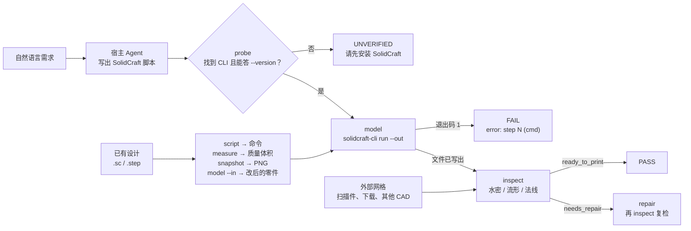

# 3d-fabric

**面向 3D 建模与制造工作流的打印质量门，自带 30 个 Blender 技能。**

使用它不需要你先准备验证环境。一个门管住网格走过的每条路：自然语言经本机 SolidCraft CLI 建模、别人发来的设计、扫描仪出的 STL、Blender 导出的网格。七个 CAD 动作共用一套记录格式与一套退出码，另有 30 个 Blender 技能覆盖"不是有尺寸的零件"的那一半 3D 工作。

- **对 Agent：** 每个动作都写一份类型化 gate，`--json` 与落盘文件逐字节一致；缺 SolidCraft 时明确报 `UNVERIFIED`，而不是默默放行。
- **对人：** 一个任务一条命令，判定只有三个词，`repair` 会逐步说明它改了什么。
- **对打印机：** 水密性、绕序、非流形边，每个封闭壳单独检查——一个里外反了的零件藏不进一个正确的零件后面。

[English](README.md) · **简体中文**

**版本：** 1.1.1 | **许可：** MIT | **Python：** 3.10+ | **SolidCraft：** 已验证于 0.30.1

> 社区插件，与 SolidCraft 项目没有隶属关系。使用前请读[安全与开源声明](#安全与开源声明)。

---

## 目录

**开始**

- [为什么需要 3d-fabric？](#为什么需要-3d-fabric)
- [安装与下载](#安装与下载)
- [快速上手](#快速上手)

**怎么工作**

- [Blender 那一半](#blender-那一半)
- [一次运行怎么走](#一次运行怎么走)
- [完整参考](#完整参考)
- [安全与开源声明](#安全与开源声明)
- [随附第三方材料](#随附第三方材料)

**其余**

- [已知局限](#已知局限)
- [报告问题](#报告问题)
- [致谢](#致谢)
- [商标声明](#商标声明)
- [开源许可](#开源许可)

---

## 为什么需要 3d-fabric？

Agent 能写参数化 CAD 脚本，但它看不出结果能不能打印；而"建出来了"也不等于"能打印"。SolidCraft 对一次完全没切中的切除照样返回 `ok`，退出码 0 也不代表文件真的写了出去，切片软件则会对一个处处不闭合的网格直接拒收。回答这些问题的工具通常是分开的：一个建模技能产零件、一个审计技能判断它、一个查看器看它、再一个脚本修补别人发来的破损 STL。

3d-fabric 从两个层面回应这个问题，两者都在同一个仓库里。

- **桥负责在两种语言之间转换。** `scripts/solidcraft.py` 会在所有可能的位置找到 CLI（`--solidcraft`、`SOLIDCRAFT_CLI`、`SOLIDCRAFT_HOME`、`PATH`，以及厂商默认安装目录），用 `--version` 验活以保证 `PATH` 上的旧壳子混不进来，带 `--out` 执行脚本，再逐一确认承诺的文件真实存在且非空。同一个桥也回答"别人做的设计"的问题：`script` 把 `.sc` 还原成命令列表，`model --in` 在它上面重放补丁，`measure` 从 B-rep 读出体积、质量与拓扑，`snapshot` 渲染成 PNG。
- **门提供桥自己给不出的判定。** `scripts/engine.py` 测量切片软件真正在意的东西——水密性、绕序一致性、法线朝向、非流形边、边界环、退化面、包围盒与带符号体积——并归纳成 `ready_to_print`、`needs_repair`、`blocked` 三档。每个缺陷都带代码、严重级别与计数。失败的模型永远不会被报告为成功。
- **两半有意解耦。** `inspect` 与 `repair` 完全不需要 SolidCraft，所以扫描件、下载件、别家 CAD 出的网格，在一台从未装过 CAD 的机器上照样能查能修。

**什么时候用哪一半。** 有尺寸、要打印的零件是 CAD：`run.py` 加 SolidCraft。轮廓、表面质感或运动才是重点的东西是 Blender：随附技能，需要本机 Blender 和 Blender MCP。两半共享一条交付路径——Blender 的网格要打印，先导出 STL，再走 `run.py --action inspect` 与 `repair`。

---

## 安装与下载

请按一个完整插件安装：`run.py`、`scripts/` 与 `skills/` 共用同一个引擎，拆散目录会失效。

**大多数人应该用方法一：让 AI 帮你装。** 宿主有插件市场、且你更愿意自己注册 URL，用方法二；要一次装到多台机器或多个宿主，用方法三。

### 前置：装 SolidCraft

3d-fabric 不含实体核，只驱动本机已安装的 SolidCraft。它开源免费（MIT OR Apache-2.0），需要你自己装：

| 平台 | 下载 |
| --- | --- |
| Windows | [solidcraft-windows-x64.msi](https://github.com/tangency-labs/solidcraft/releases/latest/download/solidcraft-windows-x64.msi) |
| macOS | [solidcraft-macos-universal.dmg](https://github.com/tangency-labs/solidcraft/releases/latest/download/solidcraft-macos-universal.dmg)（Apple silicon 与 Intel 共用） |
| Linux | [solidcraft-linux-x86_64.AppImage](https://github.com/tangency-labs/solidcraft/releases/latest/download/solidcraft-linux-x86_64.AppImage)，或 `sudo snap install solidcraft` |

- 完整下载页（ARM64、32 位、便携 zip、`.deb`、`.rpm`、Flatpak）：<https://solidcraft.io/download>
- Windows 安装包目前没有代码签名，SmartScreen 会拦一次：**更多信息 → 仍要运行**。
- 浏览器版 <https://solidcraft.io> 免安装，但它不提供 `solidcraft-cli`，**本插件用不了**。
- 装完 `solidcraft-cli --version` 能打印出版本号就成了；它不在 `PATH` 上时用 `--solidcraft`、`SOLIDCRAFT_CLI` 或 `SOLIDCRAFT_HOME` 指过去，细节见 [docs/INSTALL_COMMANDS_zh.md](docs/INSTALL_COMMANDS_zh.md)。

> **只有四个动作需要它**：`model`、`script`、`measure`、`snapshot`。`inspect` 与 `repair` 不需要——扫描件、下载件、别家 CAD 出的网格，在一台没装过 SolidCraft 的机器上照样能查能修。

30 个 Blender 技能还需要两样东西，都来自 Blender 生态，本插件不带：本机 [Blender](https://www.blender.org/download/)（4.x 即可），以及一个把 Blender 暴露成 `mcp__blender__*` 或 `mcp__blender_official__*` 的 Blender MCP 服务。缺任何一样，这些技能会直接说缺什么，不会假装渲染过；`run.py` 一行都不碰 Blender。

### 方法一：让 AI 帮你装

```bash
请访问 GitHub 仓库 `https://github.com/JiamingShi-JsPhys/3d-fabric` 并克隆它，然后运行 `python install.py --check --deps`。如果你的宿主有插件系统，请改为把整套作为单一插件安装；该脚本覆盖的是读规则文件的那些宿主。
```

### 方法二：从插件市场用 URL 安装

每个宿主都有自己的插件市场。把本仓库的 Git URL 注册进去，再安装它列出的插件即可（重复注册没有副作用，第二次会提示已存在）。

```bash
https://github.com/JiamingShi-JsPhys/3d-fabric
```

仓库还没公开、改了名或换了账号时也不影响安装：市场清单里 `source` 写的是相对路径 `./`，把上面这行换成你手上那个文件夹的路径即可，安装过程不访问远端。

### 方法三：用命令安装

Claude Code、Codex、dsh 与 CodeBuddy 用一行插件命令即可；Cursor、Windsurf、Cline、Continue、Roo Code、GitHub Copilot 与 opencode 读规则文件，一个脚本能把它们全部写好。各宿主的完整命令、`install.py` 的全部参数与可选能力都在这一页：**[docs/INSTALL_COMMANDS_zh.md](docs/INSTALL_COMMANDS_zh.md)**。

---

## 快速上手

两种进入方式。第一种需要先装插件；第二种只要这个仓库和一个网格。

### 在对话框里用（不用 shell、不用路径）

以插件方式装好后，技能就在一个 `/` 之后，并按任务词汇触发——「3D 打印」「参数化建模」「建一个实体模型」「做个外壳/支架」——所以第一句话就可以是需求本身：

```text
/3d-fabric  一块 120x70x8 的转接板，四角 R8 圆角，中间 40x20 通孔，四角 Ø4.5 孔距边 12mm
```

Agent 会依次探测、写 SolidCraft 脚本、调用 `model`、读 gate，然后报出尺寸、体积与判定——或者修掉失败的那一步再重跑。设计已经存在时，它会用 `script` 读懂它、`measure` 拿质量和体积、`snapshot` 出图、`model --in` 落改动。完整操作规则（包括怎么读 `error: step N`）见 [skills/3d-fabric/SKILL.md](skills/3d-fabric/SKILL.md)。

### 在终端里用（这一段不需要 SolidCraft）

```bash
python -m pip install -r requirements.txt
python run.py --action inspect --input examples/damaged_part.stl
```

```text
3d-fabric · inspect
  file          examples/damaged_part.stl  (stl)
  size          20.000, 20.000, 16.474  mm (assumed)
  vertices      533   faces 1028   bodies 1
  volume        n/a (open) mm^3
  surface area  1005.864528 mm^2
  topology      watertight[!!] winding[OK] outward[n/a] manifold[OK]
  defects       holes 1   boundary edges 36   non-manifold edges 0   degenerate faces 0
  verdict       needs_repair
    - [error] not_watertight x36: surface is open; a slicer cannot tell inside from outside
    - [error] holes x1: boundary loops that need filling
```

再把它修成切片软件能接受的样子：

```bash
python run.py --action repair --input examples/damaged_part.stl --output repaired.stl
```

```text
  before        watertight=False holes=1 non-manifold=0 verdict=needs_repair
  after         watertight=True holes=0 non-manifold=0 verdict=ready_to_print
  volume        3725.755796 mm^3
  written       <cwd>/repaired.stl
```

两段输出都是本仓库在 `examples/damaged_part.stl` 上的真实结果。

### 七个动作

| 动作 | 作用 | 需要 SolidCraft |
| --- | --- | --- |
| `probe` | 定位并验活 CLI | ——（就是找它） |
| `model` | 跑脚本、导出、自动体检；`--in` 修改已有设计 | **是** |
| `script` | 把 `.sc` / `.step` 还原成 `{"commands": [...]}` 脚本 | **是** |
| `measure` | 从 B-rep 读体积、质量、面积、包围盒、面类型与参数 | **是** |
| `snapshot` | 渲染 PNG 预览（视角、剖切、按 body 设色） | **是** |
| `inspect` | 任意网格的打印前报告 | 否 |
| `repair` | 焊点、补洞、修法线 | 否 |

```bash
python run.py --action probe
python run.py --action model    --input examples/bracket_request.json --quality fine
python run.py --action script   --input bracket.sc --output build.json
python run.py --action model    --script widen.json --in bracket.sc --output bracket_150.stl
python run.py --action measure  --input bracket.sc
python run.py --action snapshot --input bracket.sc --output bracket.png --view iso
python run.py --action inspect  --input examples/damaged_part.stl
python run.py --action repair   --input examples/damaged_part.stl --center
```

所有能力都能在脚本与 CI 中无头运行：给了 `--root` 时，gate 写到 `<root>/process/gates/3d-fabric_<时间戳>.json`，内容与 stdout 的 `--json` 行逐字节一致。

---

## Blender 那一半

`skills/` 里随附 30 个技能，逐字来自 [RobLe3/cc-blender-skill](https://github.com/RobLe3/cc-blender-skill) 的 commit `a2634b5`（MIT）。分三族：

| 族 | 技能数 | 负责 |
| --- | --- | --- |
| 制作 | 11 | 建模、材质、灯光、相机、渲染、动画、导出、UV 贴图、工作流 |
| HUD 与动画质量门 | 2 | 环绕主体的 HUD 运动，以及专门否决坏动画的门 |
| 按参考图重建 | 17 | 按参考图、正交线框图、品牌/吉祥物素材重建模型 |

它们需要本机 Blender 与一个 Blender MCP 服务（`mcp__blender__*` 或 `mcp__blender_official__*`）；缺了这些，CAD 那一半照常工作。每个技能各自负责什么，见 **[docs/BLENDER_SKILLS_zh.md](docs/BLENDER_SKILLS_zh.md)**。

---

## 一次运行怎么走

`run.py` 是七个动作之上的薄 CLI。`probe` 是对环境的把关；`model`、`script`、`measure`、`snapshot` 需要它，`inspect` 与 `repair` 不需要。



这张图说明三件事：

- **`probe` 是唯一的环境门。** 只有 `--version` 退出码为 0 时它才接受一个 CLI，所以 `PATH` 上的旧壳子会被拒绝而不是被使用。四个动作需要它；`inspect` 与 `repair` 不需要。
- **写出的文件要被检查，而不是假定。** 命令列表里没带导出命令时 SolidCraft 会以退出码 0 结束却不落盘，因此 `model` 会逐一核实承诺的文件存在且非空，把这种静默执行判为 `FAIL`。
- **本插件建的零件与外部网格走同一个门。** 无论出自 `model` 还是扫描仪，`inspect` 都给出同一套缺陷代码与同样三档判定。

建模成功会并排产出三个文件：网格（`bracket.stl`）、可编辑设计（`bracket.sc`）和生成它的原始脚本（`bracket.solidcraft.json`）。用 SolidCraft 打开 `.sc` 改参数再导出，或者直接重跑脚本，都能复现这个零件——而 `script` 能把这份命令列表从一个"没带原始脚本"的设计里找回来。

---

## 完整参考

动作参数、gate 记录、退出码、依赖对照、仓库布局与测试套件都在 **[docs/REFERENCE_zh.md](docs/REFERENCE_zh.md)** 里，所以这一页可以只当快速上手。

最先会遇到的三句话：`ready_to_print` 是过，`needs_repair` 是有缺陷但这个插件能修，`blocked` 是修不了——非流形边、空文件、零厚度零件。

---

## 安全与开源声明

> **免责声明**：本仓库是为自动化 3D 建模流程而编写的社区插件，与 SolidCraft 项目没有隶属、赞助或背书关系。它不包含 SolidCraft 源码，不打包其二进制或资源；SolidCraft 需由用户自行安装。这里唯一复制的 SolidCraft 材料是它自己的四份 Agent 参考文档——逐字未改、按其 MIT 许可收录，并保留版权声明与 NOTICE，见[随附第三方材料](#随附第三方材料)。
>
> 插件不会把你的模型发送到任何地方：不发起网络请求、不执行 `eval`，唯一的子进程就是你本机已安装的 `solidcraft-cli`。

---

## 随附第三方材料

`references/solidcraft/` 收录了 SolidCraft 的四份 Agent 参考文档，按其 MIT 许可逐字复制，版权声明与 NOTICE 一并保留。这个目录里没有任何东西注册为技能，`run.py` 也不执行它；删掉这个目录，`run.py` 照常工作。

收了什么、为什么收、唯一的例外，以及 MIT 的边界在哪，见 **[docs/THIRD_PARTY_zh.md](docs/THIRD_PARTY_zh.md)**。

---

## 已知局限

### 用之前先读

- **把关只查几何，不查意图。** 一个水密模型仍可能是错的零件。把报告里的 `volume` 与 `extents` 和你算的值对一遍；SolidCraft 对完全没切中的切除照样报成功。
- **不做切片。** G-code、支撑、悬垂与壁厚分析属于切片软件；3d-fabric 止于打印判定。
- **非流形边只报告、不修复。** 三个面共用的边会让 `success` 保持 `false`，剩余数量留在 `after.topology`；要拆开得用 CAD 工具。
- **STEP 不做体检。** 它是 B-rep，没有三角网格；请先导出 STL。
- **单位是假定值。** STL 不带单位；报告按 `mm` 处理并标注这是假设。

### 边界情况

- **补洞是平面扇面。** 出平面厚度超过半径 5% 的环会被跳过并写明原因，而不是硬填；跨越孔洞的曲面不会被重建。
- **不做自交检测**——`trimesh` 没有稳健实现，所以自交的网格仍可能过门。
- **`--quality fine|finest` 需要 JSON 脚本。** 网格精度在 SolidCraft 里是导出命令的参数，所以精度会被注入脚本；`.sc` 设计只能用默认精度并在 `notes` 里说明。
- **`script` 是重建，不是源文件。** 依赖保存设计状态的步骤（SolidCraft 的 `timeline.add`）会连带 CLI 自己的 replay 说明一起进 gate；用 `model` 重放它，不要假设能逐字节还原。
- **一次一个模型。** 装配体通过 `body_count` 报告，不拆分、不摆放。
- **Blender 技能是上游文本。** 它们的行为取决于你接的 Blender MCP 服务与 Blender 版本；哈希测试只能发现文件漂移，发现不了 Blender 的变化。

---

## 报告问题

**普通缺陷 / 功能建议**：请发到仓库的 [Issues](https://github.com/JiamingShi-JsPhys/3d-fabric/issues)。请附上 gate JSON、能复现问题的脚本（或最小脚本），以及 `python run.py --action probe` 报出的 SolidCraft 版本。

**安全漏洞（仅限此类）**：请**不要**用公开 Issues。请邮件至 `jiamingshi_git@outlook.com`。

- **标题**：必须以 `report_3d-fabric:` 前缀开头，后接简短摘要。
  - 示例：`report_3d-fabric: requirement JSON can write outside the output directory`
- **正文**：必须包含复现步骤、确切命令行与环境。

*提交清晰、可复现的 issue 或 PR 的贡献者，会在下一个版本的发布说明与[致谢](#致谢)中列出。*

---

## 致谢

wlheyuyang

[完整致谢](docs/ACKNOWLEDGEMENTS_zh.md)

---

## 商标声明

"SolidCraft" 是本插件所驱动的开源 CAD 应用之名，此处仅用于说明兼容对象。3d-fabric 是独立的第三方插件，与 SolidCraft 项目及其贡献者没有隶属、赞助或背书关系。

---

## 开源许可

MIT。见 [LICENSE](LICENSE) 与 [THIRD_PARTY_LICENSES.txt](THIRD_PARTY_LICENSES.txt)。

**作者与维护者**：Jiaming Shi
