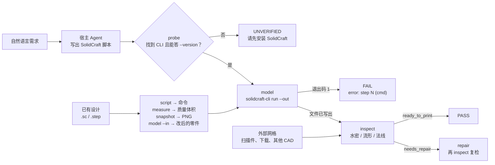

# 3d-fabric

> **面向本机 SolidCraft 安装的 CAD 前端与打印质量门，自带 30 个 Blender 技能。**
>
> 使用它不需要你先写 SolidCraft 命令列表：七个 CAD 动作随仓库一起交付，直接驱动你本机已装的 SolidCraft。`model` 写出 `{"commands": [...]}` 脚本、静默执行并导出 STL / STEP / 3MF / OBJ；`script` 从一份没带源文件的 `.sc` 或 `.step` 里把命令列表还原出来；`measure` 从 B-rep 读出体积、质量与拓扑；`snapshot` 渲染 PNG；`inspect` 给出网格的打印判定；`repair` 修掉它能修的缺陷。另有 30 个 Blender 技能逐字随附，覆盖另一种 3D 工作——有机与硬表面建模、材质、灯光、相机、渲染、UV 贴图与动画。全部内容都在安装包里，按交付状态即可运行。
>
> `scripts/solidcraft.py` 是唯一认识 SolidCraft CLI 的文件：它探测安装位置，只有 `--version` 有应答才接受，执行脚本，并且在承诺的导出文件没有真正落盘时拒绝报告成功。`scripts/engine.py` 是唯一认识几何的文件，所有运算都委托给 `trimesh`（MIT）。`run.py` 只负责编排这七个动作。

[English](README.md) · **简体中文**

**版本：** 1.1.1 | **CAD 动作：** 7 | **随附 Blender 技能：** 30 | **已验证于：** SolidCraft 0.30.1

**先装 [SolidCraft](https://solidcraft.io/download)，再装本插件。** 想用 Blender 那一半的话还要本机 Blender 与 Blender MCP。各平台命令与自检都在[安装与下载](#安装与下载)里。

---

## 安全与开源声明

> **免责声明**：本仓库是为自动化 3D 建模流程而编写的社区插件，与 SolidCraft 项目没有隶属、赞助或背书关系。它不包含 SolidCraft 源码，不打包其二进制或资源；SolidCraft 需由用户自行安装。这里唯一复制的 SolidCraft 材料是它自己的四份 Agent 参考文档——逐字未改、按其 MIT 许可收录，并保留版权声明与 NOTICE，见[随附第三方材料](#随附第三方材料)。
>
> 插件不会把你的模型发送到任何地方：不发起网络请求、不执行 `eval`，唯一的子进程就是你本机已安装的 `solidcraft-cli`。

---

## 为什么需要 3d-fabric？

Agent 能写参数化 CAD 脚本，但它看不出结果能不能打印；而“建出来了”也不等于“能打印”。SolidCraft 对一次完全没切中的切除照样返回 `ok`，退出码 0 也不代表文件真的写了出去，切片软件则会对一个处处不闭合的网格直接拒收。回答这些问题的工具通常是分开的：一个建模技能产零件、一个审计技能判断它、一个查看器看它、再一个脚本修补别人发来的破损 STL。各管一段，报告格式还互不相同，于是 Agent 要去调和几份判定，人要去记住该信哪一份。

3d-fabric 从两个层面回应这个问题，两者都在同一个仓库里。

**桥负责在两种语言之间转换。** Agent 说自然语言，SolidCraft 吃 JSON 命令列表。`scripts/solidcraft.py` 会在所有可能的位置找到 CLI（`--solidcraft`、`SOLIDCRAFT_CLI`、`SOLIDCRAFT_HOME`、`PATH`，以及厂商默认安装目录），用 `--version` 验活以保证 `PATH` 上的旧壳子混不进来，带 `--out` 执行脚本，再逐一确认承诺的文件真实存在且非空。同一个桥也回答“别人做的设计”的问题：`script` 把 `.sc` 还原成命令列表，`model --in` 在它上面重放补丁，`measure` 从 B-rep 读出体积、质量与拓扑，`snapshot` 渲染成 PNG。退出码、stderr 与逐步结果清单全部汇入同一份报告。

**门提供桥自己给不出的判定。** `scripts/engine.py` 测量切片软件真正在意的东西：水密性、绕序一致性、法线朝向、非流形边、边界环及其数量、退化面、包围盒与带符号体积——每个封闭壳单独检查，所以一个很小的反向零件藏不进一个大的正确零件后面。判定只有三档：`ready_to_print`、`needs_repair`、`blocked`，每个缺陷都带代码、严重级别与计数。失败的模型永远不会被报告为成功。

**什么时候用哪一半。** 有尺寸、要打印的零件是 CAD：`run.py` 加 SolidCraft。轮廓、表面质感或运动才是重点的东西是 Blender：随附技能，需要本机 Blender 和 Blender MCP。两半共享一条交付路径——Blender 的网格要打印，先导出 STL，再走 `run.py --action inspect` 与 `repair`。

两半有意解耦：`inspect` 与 `repair` **完全不需要** SolidCraft。来自扫描仪、下载或别的软件的网格，在一台从未装过 CAD 的机器上照样能查、能修。

---

## 随附第三方材料

`references/solidcraft/` 收录了 SolidCraft 为它自己的 MCP 服务发布的四份 Agent 参考文档——**modeling**、**editing**、**checking**、**mechanisms**——连同 `solidcraft-checking` 一起分发的小工具脚本和设计模板。本插件的技能靠它们查命令形状、平面轴、id、回复大小，以及那些“建出来但几何是错的”陷阱。

准确地说：

- **逐字。** 每个文件都与上游 `github.com/tangency-labs/solidcraft` 的 `main` 分支字节一致（2026-11-06 取回）。没有改写、删节或合并。逐文件 SHA-256 见 [`references/solidcraft/README.md`](references/solidcraft/README.md)。
- **是参考资料，不是技能。** 文件头里的 YAML frontmatter 是上游原文的一部分；这个目录里没有任何东西注册为 Claude Code 技能，`run.py` 也不会执行其中任何一行。
- **MIT，声明完整。** SolidCraft 是 MIT OR Apache-2.0 双许可，这里按 **MIT** 收取。版权归 SolidCraft contributors（2026）。[`references/solidcraft/LICENSE-MIT`](references/solidcraft/LICENSE-MIT) 是完整 MIT 文本，[`NOTICE`](references/solidcraft/NOTICE) 是上游的署名文件。这些文件仍属贡献者版权，不在 3d-fabric 自己的 MIT 授权范围内；`references/solidcraft/` 之外的部分是 Jiaming Shi 的 MIT 作品。
- **可选。** 删掉这个目录，`run.py` 照常工作——只是失去内置命令参考，回退到 `solidcraft-cli commands`。

上游文本按 SolidCraft 的 MCP 工具名书写（`batch`、`execute`、`measure`）；`{"commands": [...]}` 里的命令名与之一致，但 MCP 的调用名 `solidcraft-cli run` 不认。两者冲突时以 `solidcraft-cli commands` 为准。

---

## Blender 那一半

`skills/` 里随附 30 个技能，逐字来自 [RobLe3/cc-blender-skill](https://github.com/RobLe3/cc-blender-skill) 的 commit `a2634b5`（MIT）。每个技能都在 `allowed-tools` 里声明了自己的 Blender MCP 工具，所以只有在接了 Blender MCP 的会话里才会激活。

| 技能 | 负责 |
| --- | --- |
| `text-to-blender` | 路由：判断该用哪个子技能、MCP 后端说明、装配顺序 |
| `blender-modeling` | 网格、基本体、修改器、bmesh、硬表面 |
| `blender-materials` | Principled BSDF、金属度开关、清漆/织物/次表面/透射、程序化纹理 |
| `blender-lighting` | 三点布光、HDRI、色温、灯光分组 |
| `blender-cameras` | 焦距、景深、构图、动画相机 |
| `blender-rendering` | Cycles 与 EEVEE、采样、降噪、AgX/Filmic、输出格式 |
| `blender-animation` | 关键帧、F 曲线、缓动、形态键、驱动器、NLA |
| `blender-export` | glTF/GLB、FBX、OBJ、USD、STL、碰撞体、法线烘焙 |
| `blender-uv-texturing` | 展开、图集、投影、烘焙、贴花 |
| `blender-pro-workflow` | 场景装配顺序、评审协议、时间预算 |
| `blender-skill-harmonizer` | 多个技能同时适用时的优先级与交接 |
| `orbital-hud-motion` | 环绕主体的 HUD 圆环、光晕、轨道弧 |
| `animation-quality-gate` | 接触表、闪烁与剪影检查，决定一段动画收不收 |

另外 17 个负责**按参考图重建**——“必须和这张图一模一样”靠的就是这一族：

| 技能 | 负责 |
| --- | --- |
| `reference-to-3d` | 从参考图、正交视图、品牌/吉祥物素材重建 |
| `wireframe-to-3d` | 正交线框图 → 模型，导出 glTF/GLB |
| `mascot-logo-reconstruction` | 带失败门、锁定源文件的吉祥物/标志/头像重建 |
| `orthographic-registration` | 把前/侧/后/顶视图注册进同一套坐标约定 |
| `multiview-constraint-solver` | 判断一个刚体能否满足全部视图，先出约束（不需要 Blender 工具） |
| `multiview-fit-loop` | 对照模板“比较—调整—重复”的闭环拟合 |
| `fit-repair-optimizer` | 把拟合报告变成修复队列 |
| `landmark-fit-repair` | 按命名地标（尖角、边缘、眼睛、轮缘厚度）修形 |
| `reference-analysis-validator` | 在宣称 1:1 之前校验参考素材 |
| `reference-look-calibration` | 对着原图校准材质、灯光、裁切、发光与 HUD 风格 |
| `source-part-segmentation` | 规划参考图如何拆成零件（不需要 Blender 工具） |
| `contour-to-mesh` | 用提取出的轮廓与蒙版直接生成曲面 |
| `atlas-uv-fitting` | 把每个源零件映射到自己的图集矩形 |
| `closed-surface-uv-coverage` | 保证封闭/挤出件的端面与侧壁都被贴图覆盖 |
| `texture-driven-mesh-fitting` | 按贴图或贴花轮廓重塑几何 |
| `texture-state-animation` | 贴图状态切换，不要整图淡入淡出或跳变 |
| `quality-refinement-autoloop` | 结果不达标时自我精修 |

**这一半需要什么：** 本机装有 Blender，并接上一个 Blender MCP（ahujasid/blender-mcp 的 `mcp__blender__*`，或 `mcp__blender_official__*`）。没有它们，CAD 一半照常工作；Blender 技能会直接说缺什么，不会假装渲染过。

**这里不改它们。** 它们是上游文本；路由和本地建议写在 `skills/3d-fabric/SKILL.md` 与 `AGENTS.md` 里。`skills/vendored.json` 记录上游取回日期和每个文件的 SHA-256，`tests/test_bundled_skills.py` 在文件与哈希不一致时报错。

---

## 一次运行怎么走

`run.py` 是七个动作之上的薄 CLI。`probe` 是对环境的把关；`model`、`script`、`measure`、`snapshot` 需要它，`inspect` 与 `repair` 不需要。



这张图说明三件事：

- **`probe` 是唯一的环境门。** 只有 `--version` 退出码为 0 时它才接受一个 CLI，所以 `PATH` 上的旧壳子会被拒绝而不是被使用。四个动作需要它；`inspect` 与 `repair` 不需要。
- **写出的文件要被检查，而不是假定。** 命令列表里没带导出命令时 SolidCraft 会以退出码 0 结束却不落盘，因此 `model` 会逐一核实承诺的文件存在且非空，把这种静默执行判为 `FAIL`。
- **本插件建的零件与外部网格走同一个门。** 无论出自 `model` 还是扫描仪，`inspect` 都给出同一套缺陷代码与同样三档判定。

建模成功会并排产出三个文件：网格（`bracket.stl`）、可编辑设计（`bracket.sc`）和生成它的原始脚本（`bracket.solidcraft.json`）。用 SolidCraft 打开 `.sc` 改参数再导出，或者直接重跑脚本，都能复现这个零件——而 `script` 能把这份命令列表从一个“没带原始脚本”的设计里找回来。

---

## 安装与下载

请按一个完整插件安装：`run.py`、`scripts/` 与 `skills/` 共用同一个引擎，拆散目录会失效。

### 前置：装 SolidCraft

3d-fabric 不含实体核，只驱动本机已安装的 SolidCraft。它开源免费（MIT / Apache-2.0 双许可），需要你自己装：

| 平台 | 下载 |
| --- | --- |
| Windows | [solidcraft-windows-x64.msi](https://github.com/tangency-labs/solidcraft/releases/latest/download/solidcraft-windows-x64.msi) |
| macOS | [solidcraft-macos-universal.dmg](https://github.com/tangency-labs/solidcraft/releases/latest/download/solidcraft-macos-universal.dmg)（Apple silicon 与 Intel 共用） |
| Linux | [solidcraft-linux-x86_64.AppImage](https://github.com/tangency-labs/solidcraft/releases/latest/download/solidcraft-linux-x86_64.AppImage)，或 `sudo snap install solidcraft` |

- 完整下载页（ARM64、32 位、便携 zip、`.deb`、`.rpm`、Flatpak）：<https://solidcraft.io/download>
- Windows 安装包目前没有代码签名，SmartScreen 会拦一次：**更多信息 → 仍要运行**。
- 浏览器版 <https://solidcraft.io> 免安装，但它不提供 `solidcraft-cli`，**本插件用不了**。

装完 `solidcraft-cli --version` 能打印出版本号就成了；它不在 `PATH` 上时用 `--solidcraft`、`SOLIDCRAFT_CLI` 或 `SOLIDCRAFT_HOME` 指过去，细节见 [docs/INSTALL_COMMANDS_zh.md](docs/INSTALL_COMMANDS_zh.md)。

> **只有四个动作需要它**：`model`、`script`、`measure`、`snapshot`。`inspect` 与 `repair` 不需要——扫描件、下载件、别家 CAD 出的网格，在一台没装过 SolidCraft 的机器上照样能查能修。

### 前置：Blender（想用那一半才装）

三十个 Blender 技能需要两样东西，都来自 Blender 生态，本插件不带：

1. **本机 Blender** —— <https://www.blender.org/download/>（4.x 即可）
2. **一个 Blender MCP 服务**，把 Blender 暴露成 `mcp__blender__*` 或 `mcp__blender_official__*` 工具组

缺任何一样，Blender 技能会直接说缺什么，不会假装渲染过；CAD 那一半完全不受影响，`run.py` 一行都不碰 Blender。

### 方法一：从插件市场用 URL 安装

每个宿主都有自己的插件市场。把本仓库的 Git URL 注册进去，再安装它列出的插件即可（重复注册没有副作用，第二次会提示已存在）。

```bash
https://github.com/JiamingShi-JsPhys/3d-fabric
```

仓库还没公开、改了名或换了账号时也不影响安装：市场清单里 `source` 写的是相对路径 `./`，把上面这行换成你手上那个文件夹的路径即可，安装过程不访问远端。

### 方法二：用命令安装

Claude Code、Codex、dsh 与 CodeBuddy 用一行插件命令即可；Cursor、Windsurf、Cline、Continue、Roo Code、GitHub Copilot 与 opencode 读规则文件，一个脚本能把它们全部写好。各宿主的完整命令、`install.py` 的全部参数与可选能力都在这一页：**[docs/INSTALL_COMMANDS_zh.md](docs/INSTALL_COMMANDS_zh.md)**。

### 方法三：让 AI 帮你装

```bash
请访问 GitHub 仓库 `https://github.com/JiamingShi-JsPhys/3d-fabric` 并克隆它，然后运行 `python install.py --check --deps`。如果你的宿主有插件系统，请改为把整套作为单一插件安装；该脚本覆盖的是读规则文件的那些宿主。
```

> **警告**：使用 AI 自动安装时，AI 有概率会把 `run.py` 与 `scripts/` 打散，复制到无关目录中。模块之间互相导入，散装副本会直接失效。如果你需要完整的插件功能，请使用方法一。

---

## 快速上手

### 七个动作

| 动作 | 作用 | 需要 SolidCraft |
| --- | --- | --- |
| `probe` | 定位并验活 CLI | ——（就是找它） |
| `model` | 跑脚本、导出、自动体检；`--in` 修改已有设计 | **是** |
| `script` | 把 `.sc` / `.step` 还原成 `{"commands": [...]}` 脚本 | **是** |
| `measure` | 从 B-rep 读体积、质量、面积、包围盒、面类型与参数 | **是** |
| `snapshot` | 渲染 PNG 预览（视角、剖切、按 body 设色） | **是** |
| `inspect` | 任意网格的打印前报告 | 否 |
| `repair` | 焊点、补洞、修法线 | 否 |

```bash
python run.py --action probe
python run.py --action model    --input examples/bracket_request.json --quality fine
python run.py --action script   --input bracket.sc --output build.json
python run.py --action model    --script widen.json --in bracket.sc --output bracket_150.stl
python run.py --action measure  --input bracket.sc
python run.py --action snapshot --input bracket.sc --output bracket.png --view iso
python run.py --action inspect  --input examples/damaged_part.stl
python run.py --action repair   --input examples/damaged_part.stl --center
```

### 在对话框里用

以插件方式装好后，技能就在一个 `/` 之后，并按任务词汇触发——「3D 打印」「参数化建模」「建一个实体模型」「做个外壳/支架」，或要求切片前检查一个 STL。

```text
/3d-fabric  一块 120x70x8 的转接板，四角 R8 圆角，中间 40x20 通孔，四角 Ø4.5 孔距边 12mm
```

Agent 会依次探测、写 SolidCraft 脚本、调用 `model`、读 gate，然后报出尺寸、体积与判定——或者修掉失败的那一步再重跑。设计已经存在时，它会用 `script` 读懂它、`measure` 拿质量和体积、`snapshot` 出图、`model --in` 落改动。完整操作规则（包括怎么读 `error: step N`）见 [skills/3d-fabric/SKILL.md](skills/3d-fabric/SKILL.md)。

### 需要命令行时

所有能力都能在脚本与 CI 中无头运行：动作集、变换参数、gate JSON 结构与退出码见 [skills/3d-fabric/SKILL.md](skills/3d-fabric/SKILL.md)。

```bash
python run.py --action model --input req.json --root ./ws --json
```

给了 `--root` 时，gate 写到 `<root>/process/gates/3d-fabric_<时间戳>.json`，内容与 stdout 的 `--json` 行逐字节一致。

---

## 环境要求

Python 3.10+ 以及 `trimesh`、`numpy`、`scipy`——都是宽松许可（MIT / BSD-3-Clause），用 `python -m pip install -r requirements.txt` 安装。

**SolidCraft 只有 `model`、`script`、`measure`、`snapshot` 需要**，插件不附带它，下载方式见上面的[前置：装 SolidCraft](#前置装-solidcraft)（MIT OR Apache-2.0，<https://solidcraft.io/download>）。`probe` 会从 `--solidcraft`、`SOLIDCRAFT_CLI`、`SOLIDCRAFT_HOME`、`PATH` 或常见安装目录取用 CLI，并对每个候选跑 `--version` 验活——答不出来的文件不会被接受。

**Blender 与 Blender MCP** 是那 30 个技能的前提，同样不随插件分发，见[前置：Blender](#前置blender想用那一半才装)（Blender 从 <https://www.blender.org/download/> 取）。只有 `mcp__blender__*` 或 `mcp__blender_official__*` 工具在场时它们才会激活。`run.py` 的任何一行都不会碰 Blender。

本仓库不 vendor 任何第三方代码。`numpy-stl` 只出现在测试里，作为独立 STL 读取器，用来证明导出文件是标准 STL。

---

## 仓库布局

```text
3d-fabric/
├── .claude-plugin/                   # Claude Code 插件清单 + 市场
├── .clinerules/                      # Cline 规则文件
├── .codebuddy-plugin/                # CodeBuddy 插件清单 + 市场
├── .codex-plugin/                    # Codex 插件清单 + 市场（含 interface）
├── .continue/rules/                  # Continue 规则文件
├── .cursor/rules/                    # Cursor 规则文件（.mdc）
├── .dsh-plugin/                      # dsh 目录式入口（转调 index.js）
├── .github/                          # GitHub Copilot 规则文件
├── .gitattributes                    # 统一 LF；二进制网格标记
├── .gitignore
├── .roo/rules/                       # Roo Code 规则文件
├── .windsurf/rules/                  # Windsurf 规则文件
├── AGENTS.md                         # Agent 操作规则——六份规则文件的正文
├── CHANGELOG.md                      # 发布说明
├── LICENSE                           # MIT
├── README.md                         # English
├── README_zh.md                      # 本文件
├── THIRD_PARTY_LICENSES.txt          # 上游许可清单 + 与 SolidCraft 的关系
├── cordis.patch.yml                  # dsh：把插件插入 profile
├── docs/
│   ├── INSTALL_COMMANDS.md           # 各宿主完整安装命令、install.py 全部参数
│   ├── INSTALL_COMMANDS_zh.md        # 同上，中文
│   └── DEPENDENCIES.md               # 能力—依赖—缺失时行为的矩阵
├── examples/
│   ├── bracket_request.json          # 自然语言 + 21 条 SolidCraft 命令
│   ├── damaged_part.stl              # 带孔的球体，用于 inspect / repair 演示
│   └── make_demo.py                  # 重新生成 damaged_part.stl
├── index.js                          # dsh 入口：把每个 skills/*/SKILL.md 注册进技能表
├── install.py                        # --check / --deps / --skill-dir / --project / --global
├── licenses/
│   └── cc-blender-skill-LICENSE.txt  # 随附技能的上游 MIT 文本
├── manifest.json                     # 技能管线元数据（stage、动作、依赖）
├── package.json                      # dsh 包清单（dsh.bundle.patch）
├── pyproject.toml                    # 包元数据 + pytest/pyright 配置
├── requirements.txt
├── references/
│   └── solidcraft/                   # SolidCraft 四份 Agent 参考，逐字收录（MIT）
│                                     #   README.md：来源、哈希、更新步骤
├── run.py                            # CLI：probe / model / script / measure /
│                                     #      snapshot / inspect / repair
├── scripts/
│   ├── engine.py                     # trimesh 几何：加载、变换、分析、修复、导出
│   └── solidcraft.py                 # CLI 桥：探测、执行、eval、snapshot、script
├── skills/
│   ├── vendored.json                 # 上游地址、取回日期、逐文件 SHA-256
│   ├── 3d-fabric/                    # 本插件自己的技能：CAD 一半 + 路由
│   └── <30 个 Blender 技能>/          # 逐字来自 github.com/RobLe3/cc-blender-skill
│                                     #   （MIT）：11 个制作 + 2 个 HUD/动画 QA
│                                     #   + 17 个按参考图重建
└── tests/
    ├── conftest.py                   # 运行时生成的夹具（仓库里不放二进制）
    ├── stub_solidcraft.py            # CLI 测试桩件
    ├── test_actions.py               # measure / snapshot / script、model --in
    ├── test_bundled_skills.py        # Blender 技能齐全、绑定 MCP、哈希一致
    ├── test_cli.py                   # 退出码、gate 文件、stdout 契约
    ├── test_dsh_bundle.py            # dsh.bundle.patch、CJS 入口、版本一致
    ├── test_engine.py                # 几何、缺陷、修复、导出
    ├── test_install.py               # --check、--skill-dir、参数处理
    ├── test_model.py                 # 完整建模 → 体检链路
    ├── test_plugin_manifests.py      # 四份插件清单 + 六份规则文件不许漂移
    ├── test_references.py            # SolidCraft 参考齐全、哈希一致
    └── test_solidcraft.py            # 探测、执行、失败与"静默不写文件"
```

---

## 测试

```bash
python -m pytest
```

共 137 个用例，全部通过。覆盖几何引擎（STL 加载时的顶点焊接、绕支点的变换、绕序、反向壳体、空腔与反向零件的区分、每一类缺陷、四边形与 32 边形边界的补洞、用独立 STL 读取器验证的导出往返）、CLI 契约（退出码、gate 文件、人类可读与 `--json` 两种输出）、读设计的动作（`measure` 的总量与开口体、`snapshot` 的 PNG 产物、`script` 的还原、`model --in`）、随附参考（文件齐全、按 README 表校验 SHA-256、MIT 文本、`install.py --skill-dir` 会一并复制）、随附 Blender 技能（齐全、frontmatter 名字与目录一致、每个都绑定 Blender MCP 工具、跨技能相对链接可解析、哈希与 `skills/vendored.json` 一致）、dsh 包（`dsh.bundle.patch` 声明、CJS 入口能列出全部 31 个技能、与 Claude Code 清单的版本一致）、平台那一层（四份插件清单与六份规则文件，每份规则文件都锁定到 `AGENTS.md`）、安装器自身的检查，以及通过 Python 桩件驱动的 SolidCraft 桥——所以无论本机装没装 SolidCraft，测试都通过。装了真机时会额外跑一条集成用例，没装则跳过。

---

## 已知局限

如实的边界情况，依赖任何输出前请先读：

- **把关只查几何，不查意图。** 一个水密模型仍可能是错的零件。把报告里的 `volume` 与 `extents` 和你算的值对一遍；SolidCraft 对完全没切中的切除照样报成功。
- **不做切片。** G-code、支撑、悬垂与壁厚分析属于切片软件；3d-fabric 止于打印判定。
- **补洞是平面扇面。** 出平面厚度超过半径 5% 的环会被跳过并写明原因，而不是硬填；跨越孔洞的曲面不会被重建。
- **非流形边只报告、不修复。** 三个面共用的边会让 `success` 保持 `false`，剩余数量留在 `after.topology`；要拆开得用 CAD 工具。
- **不做自交检测**——`trimesh` 没有稳健实现。
- **STEP 不做体检。** 它是 B-rep，没有三角网格；请先导出 STL。
- **`--quality fine|finest` 需要 JSON 脚本。** 网格精度在 SolidCraft 里是导出命令的参数，所以精度会被注入脚本；`.sc` 设计只能用默认精度并在 `notes` 里说明。
- **`script` 是重建，不是源文件。** 依赖保存设计状态的步骤（SolidCraft 的 `timeline.add`）会连带 CLI 自己的 replay 说明一起进 gate；用 `model` 重放它，不要假设能逐字节还原。
- **一次一个模型。** 装配体通过 `body_count` 报告，不拆分、不摆放。
- **单位是假定值。** STL 不带单位；报告按 `mm` 处理并标注这是假设。

---

## 报告问题

**普通缺陷 / 功能建议**：请发到仓库的 [Issues](https://github.com/JiamingShi-JsPhys/3d-fabric/issues)。请附上 gate JSON、能复现问题的脚本（或最小脚本），以及 `python run.py --action probe` 报出的 SolidCraft 版本。

**安全漏洞（仅限此类）**：请**不要**用公开 Issues。请邮件至 `jiamingshi_git@outlook.com`。

- **标题**：必须以 `report` 前缀开头，后接产品名与简短摘要。
  - 示例：`report_3d-fabric: requirement JSON can write outside the output directory`
- **正文**：必须包含复现步骤、确切命令行与环境。

*提交清晰、可复现的 issue 或 PR 的贡献者，会在下一个版本的发布说明中致谢。*

---

## 致谢

**wlheyuyang** —— [issue #1](https://github.com/JiamingShi-JsPhys/3d-fabric/issues/1) 报告了绕序不一致的网格仍能通过打印判定，并给出了复现步骤，这一条后来成为 1.1.1 的绕序修复。

---

## 商标声明

“SolidCraft” 是本插件所驱动的开源 CAD 应用之名，此处仅用于说明兼容对象。3d-fabric 是独立的第三方插件，与 SolidCraft 项目及其贡献者没有隶属、赞助或背书关系。

---

## 开源许可

MIT。见 [LICENSE](LICENSE)。

**作者与维护者**：Jiaming Shi

该授权只覆盖本项目自己的作品：`run.py`、`scripts/`、`3d-fabric` 技能、`install.py`、文档与测试。它**不**覆盖随附的第三方材料：

- `skills/` —— 30 个 Blender 技能，© 2026 RobLe3，MIT（[许可文本](licenses/cc-blender-skill-LICENSE.txt)）。
- `references/solidcraft/` —— 四份 SolidCraft Agent 参考，© 2026 SolidCraft contributors，MIT（[许可文本](references/solidcraft/LICENSE-MIT)）。

两者都是逐字复制，声明随文件一起分发，符合 MIT 的要求。完整清单见 [THIRD_PARTY_LICENSES.txt](THIRD_PARTY_LICENSES.txt)。
